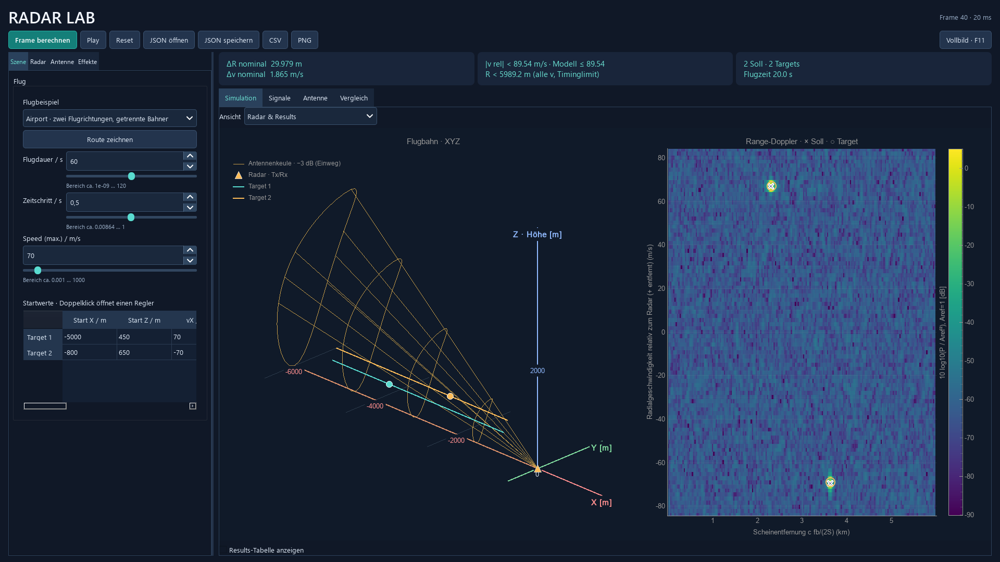
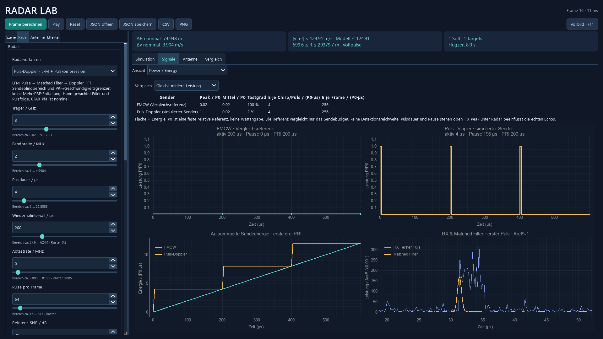
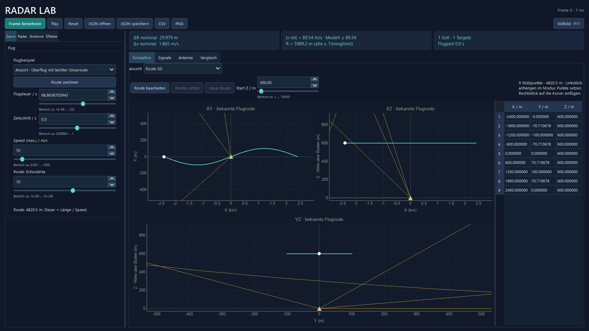
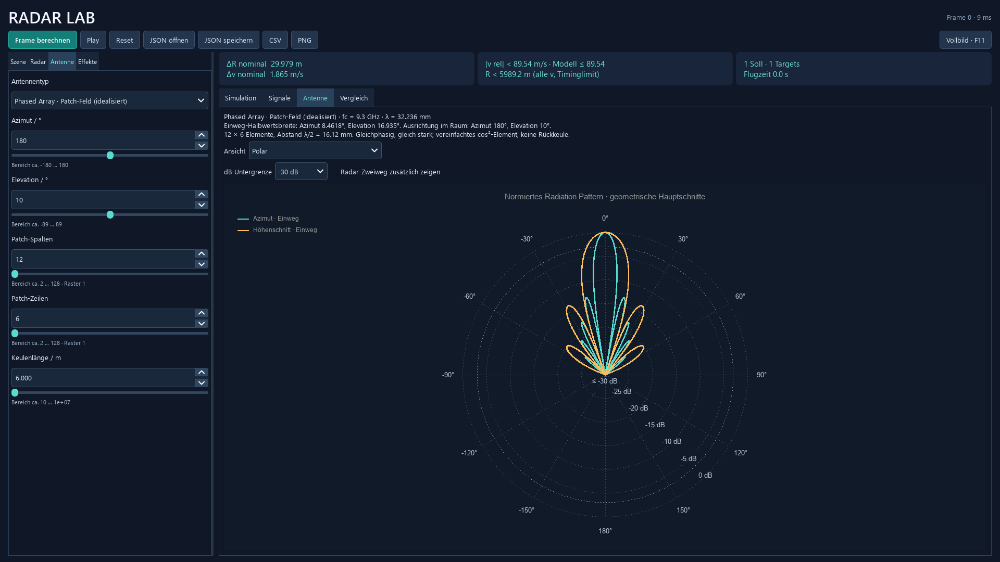
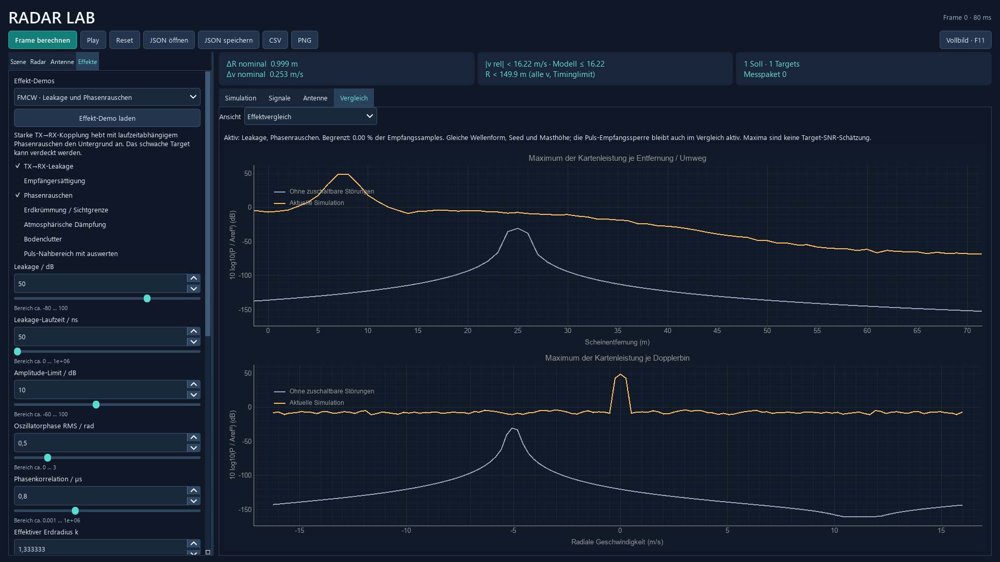

# Radar Lab – FMCW-, Puls-Doppler- und Passivradar

Eine Python-Desktop-Anwendung zur Simulation und Auswertung von Radarsignalen. Aus vorgegebenen Flugbahnen werden komplexe Empfangssignale berechnet. Je nach Radarverfahren werden daraus Entfernung und radiale Geschwindigkeit oder bistatische Messgrößen geschätzt und mit den bekannten Simulationswerten verglichen.

Das Projekt verbindet Grundlagen der Nachrichtentechnik mit numerischer Signalverarbeitung und einer grafischen Bedienoberfläche. Die Berechnungen sind im Quellcode nachvollziehbar und verwenden keine fertige Radar-Bibliothek. Eine Radarhardware wird nicht benötigt.

## Demo

[](docs/media/01_gegenverkehr.mp4)

**[Gegenverkehr ansehen – MP4, ca. 20 Sekunden](docs/media/01_gegenverkehr.mp4)** · **[Radarverfahren und Störeffekte – MP4, 32 Sekunden](docs/media/02_verfahren_und_effekte.mp4)**

Die Videos wurden aus berechneten Frames der Anwendung erstellt. Bewegte Abschnitte sind teilweise beschleunigt; Zeitraffer und Standbilder sind im Video bezeichnet. Beide Dateien haben 1920 × 1080 Pixel und enthalten keinen Ton. Falls GitHub die MP4-Datei nicht direkt abspielt, kann sie heruntergeladen und lokal geöffnet werden.

Im Bild: zwei Flugzeuge in 450 und 650 m Höhe mit entgegengesetzten Flugrichtungen. Kreuze zeigen die Sollwerte, orange Kreise die erkannten CFAR-Peaks. Die XYZ-Ansicht links verwendet bekannte Flugpositionen; sie ist keine gemessene 3D-Ortung.

---

## Verwendete Software

| Bestandteil | Umsetzung |
|---|---|
| Sprache | Python 3.11 oder neuer |
| Numerische Berechnungen | NumPy: komplexe Signale, FFTs, Fenster und Zufallsrauschen |
| Desktop-Oberfläche | PyQt6: Widgets, Signale und Hintergrundberechnung |
| Diagramme | pyqtgraph: Linienplots, Range-Doppler-Map und PNG-Export |
| Dateien und Tests | Python-Standardbibliothek: JSON, CSV und unittest |

Die Anwendung wurde unter **Windows 11** mit Python 3.14.7, NumPy 2.5.3, PyQt6 6.11.0 und pyqtgraph 0.14.0 geprüft. Die drei direkten Abhängigkeiten stehen in [requirements.txt](requirements.txt). SciPy und zusätzliche Radar- oder Testframeworks werden nicht benötigt.

## Einrichtung und Start

PowerShell im Projektordner öffnen:

```powershell
python -m venv .venv
.\.venv\Scripts\python.exe -m pip install -r requirements.txt
.\.venv\Scripts\python.exe -m radar_sim
```

Alternativ nach der Installation `start_windows.bat` doppelklicken. Mit **F11** wird zwischen Fenster und Vollbild gewechselt; **Esc** verlässt das Vollbild.

Ein gespeichertes Szenario direkt starten:

```powershell
.\.venv\Scripts\python.exe -m radar_sim --config examples\11_flughafen_gegenverkehr.json
```

---

## Funktionen und Bedienung

Die Oberfläche bündelt zusammengehörige Funktionen in vier Haupttabs je Seite:

| Bereich | Inhalt |
|---|---|
| Links: **Szene** | Flugbeispiele, eigene Route und feste Targets |
| Links: **Radar** | Radarparameter, DSP/CFAR und Einstellungen für Passivradar |
| Links: **Antenne**, **Effekte** | Antennenparameter beziehungsweise Störungen und Effekt-Demos |
| Rechts: **Simulation** | Radarübersicht mit einblendbarer Results-Tabelle; Auswahl **Route 3D** |
| Rechts: **Signale** | Auswahl **Empfang & FFT** oder **Power / Energy** |
| Rechts: **Antenne** | Auswahl **Polar** oder **Details · Schnitte und Karte** |
| Rechts: **Vergleich** | Auswahl **Effektvergleich** oder **Radarvergleich** |

Die Auswahl **Ansicht** wechselt die Darstellung innerhalb einer Funktionsfamilie. Diagramme und Einstellungen bleiben dabei erhalten. Unter **Simulation → Radar & Results** blendet **Results-Tabelle anzeigen** die Sollwerte, Schätzwerte und Fehler unter den Diagrammen ein.

### 1. Radarverfahren und Signalverarbeitung

| Verfahren | Verarbeitung | Angezeigte Messgrößen |
|---|---|---|
| **FMCW** | Mathematisch äquivalentes Dechirping, Range-FFT und Doppler-FFT | Entfernung und radiale Geschwindigkeit |
| **Puls-Doppler** | Verzögerte LFM-Pulse, Empfangssperre während des Sendens, Pulskompression und Doppler-FFT | Entfernung und radiale Geschwindigkeit |
| **Passivradar** | Synthetischer Fremdsender, Referenz-/Surveillance-Kanal, Direktweg-Unterdrückung und Cross-Ambiguity Function (CAF) | Bistatischer Umweg und dessen Änderungsrate |

Die Detektion erfolgt mit einer selbst implementierten **zweidimensionalen CA-CFAR** im linearen Leistungsbereich. Dabei wird die Detektionsschwelle aus benachbarten Zellen bestimmt. Benachbarte Treffer werden zu lokalen Peaks zusammengefasst. Die Results-Tabelle vergleicht Sollwerte, Schätzwerte und Abweichungen.

* **Radar:** Trägerfrequenz, Bandbreite, Chirp-/Pulsdauer, Wiederholintervall, Abtastrate und Wiederholungen einstellen.
* **Radar → DSP / CFAR:** Rechteck- oder Hann-Fenster, Null-Doppler-Abzug und CFAR-Parameter wählen. Rauschen und Seed stehen bei den Radarparametern.
* **Slider und Tooltips:** Wertebereiche hängen von den übrigen Eingaben ab. Ungültige Kombinationen werden erklärt und sperren die Berechnung.
* **Frame berechnen / Play / Reset:** Einzelne Messpakete berechnen, einen Flug abspielen oder zum Anfang zurückkehren. Die Berechnungen laufen im Hintergrund.

Positive radiale Geschwindigkeit bedeutet Entfernung vom Radar, negative Annäherung. Die aktive Range-Doppler-Map zeigt zunächst eine Scheinentfernung; die Ergebnistabelle korrigiert den modellierten Doppleranteil. Alle Radarpegel sind relativ zu **Aref² = 1** angegeben, nicht in dBm.

Weitere Ansichten: [Puls-Doppler mit Empfangssignal](docs/media/02_puls_doppler.png) · [Passivradar mit Fremdsender](docs/media/05_passivradar.png).

**Signale → Power / Energy** zeigt ausgefüllte Sendeleistungskurven, Tastgrad, Spitzen-/mittlere Leistung und Energie pro Frame. Der Vergleich lässt sich auf gleiche mittlere Leistung oder gleiche Spitzenleistung normieren. **Radar → TX Peak / dB** skaliert die tatsächlich simulierten aktiven Echos und Leakage bei fester Rauschreferenz. Die andere Kurve ist eine gekennzeichnete Vergleichsreferenz. Die Größen bleiben relativ, ohne behauptete Watt- oder Joulewerte. Beim Pulsradar wird außerdem der tatsächliche Empfang vor und nach der Pulskompression gezeigt. [Erklärung und Gleichungen](docs/SENDELEISTUNG.md).



### 2. Flugbahnen und bewegtes Radar



* **Beispiele:** Anflug, Gegenverkehr, Höhenbogen, räumliche Route und zwei Flugzeuge mit einem Radar auf einer bewegten Plattform.
* **Eigene Route:** Unter den Flugbeispielen **Route zeichnen** wählen. Jeder Linksklick setzt einen Stützpunkt. Punkte lassen sich in XY, XZ und YZ bearbeiten; ein Rechtsklick auf die Linie fügt einen weiteren Punkt ein.
* **Speed und Flugdauer:** Bei eigenen Routen sind beide gekoppelt. Die Route unterstützt bis zu 256 Stützpunkte.
* **XYZ-Ansicht:** Flugbahn und Antennenkeule gemeinsam betrachten, mit der Maus drehen, verschieben und zoomen.
* **Bewegtes Radar:** Entfernung und radiale Geschwindigkeit werden relativ zum Radarflugzeug berechnet.

### 3. Antennen und Radiation Patterns



Links unter **Antenne** stehen ein isotroper Vergleich, ein idealisiertes Patch-Feld sowie vereinfachte Parabol- und Fächerkeulen zur Verfügung. Richtung und passende Antennenparameter sind einstellbar.

Rechts unter **Antenne** werden die beiden Winkelschnitte als klassisches Polardiagramm sowie kartesische Schnitte und eine Winkelkarte angezeigt. Die Zweiweg-Wirkung auf das monostatische Echo lässt sich zusätzlich anzeigen. Die Antennenkeule beeinflusst die Echoamplitude; ihre Zeichenlänge legt keine maximale Detektionsentfernung fest.

### 4. Störeffekte und Radargrenzen



Links unter **Effekte → Effekt-Demos** können neun vorbereitete Demos geladen und anschließend verändert werden:

* **Leakage:** Ein verzögerter Anteil des eigenen Sendesignals gelangt in den Empfänger.
* **Empfängersättigung:** Starke Signale begrenzen die Empfangsamplitude vor der digitalen Verarbeitung.
* **Phasenrauschen:** Gemeinsame Oszillatorphase mit laufzeitabhängiger Restphase.
* **Erdkrümmung:** Effektive Erdkugel mit geometrischer Sichtprüfung und angepassten Laufwegen.
* **Atmosphäre:** Vorgegebene homogene Dämpfung in dB/km über den gesamten Signalweg.
* **Bodenclutter:** Kohärente Bodenstreuer, bei bewegtem Radar mit entsprechendem Doppler.
* **Puls-Nahbereich:** Unvollständig empfangene Pulse und der dadurch entstehende Leistungsverlust.

**Vergleich → Effektvergleich** zeigt dieselbe Szene mit und ohne die zuschaltbaren Störungen. Wellenform, Seed, Masthöhe und Puls-Empfangssperre bleiben dabei gleich. Die Referenzkurve wird nicht zur Targetdetektion verwendet.

[Bewegtes Radar mit Bodenclutter ansehen](docs/media/07_bodenclutter.png). Graue Punkte sind die modellierten Bodenstreuer; deren Echos können zusätzliche CFAR-Peaks erzeugen.

### 5. Beispiele und Exporte

Im Ordner [examples](examples/) liegen **29 JSON-Konfigurationen**, darunter:

| Beispiel | Inhalt |
|---|---|
| `11_flughafen_gegenverkehr.json` | Zwei Flugrichtungen bei ungefähr 70 m/s |
| `13_flughafen_route3d.json` | Überflug mit leichter seitlicher Sinusbewegung, 600 m Höhe und 70 m/s |
| `16_puls_doppler_air_to_air.json` | Puls-Doppler mit bewegtem Radar |
| `18_fern_puls_300km.json`, `19_fern_fmcw_300km.json` | Vergleichbare aktive Fernbereichsprofile |
| `20_passiv_beta.json` | Fremdsender, fester Empfänger und Flugzeug |
| `21_fmcw_leakage.json` bis `29_passiv_saettigung.json` | Gezielte Beispiele für Störeffekte |

**JSON** speichert die Konfiguration einschließlich Flugbahn und Effekten. **CSV** exportiert die Detektionen mit einer Begleitkonfiguration; bekannte Flugzustände werden getrennt gespeichert. **PNG** exportiert die Diagramme einschließlich Routenprojektionen, Antennendiagrammen und Effektvergleich.

---

## Projektstruktur

```text
radar_sim/       Berechnungskern und Desktop-Oberfläche
examples/        Gespeicherte Szenarien
tests/          Automatisierte Tests
docs/           Technische Dokumentation und Demomedien
reports/        Berechnete Validierungsberichte und Diagramme
tools/          Erzeugung der Demobilder und Videos
```

| Einstieg | Inhalt |
|---|---|
| [pipeline.py](radar_sim/pipeline.py) | Gesamter Ablauf eines Radarframes |
| [flugbahn.py](radar_sim/flugbahn.py) | Flugposition, Bewegung und relative Geometrie |
| [model.py](radar_sim/model.py), [processing.py](radar_sim/processing.py) | FMCW-Echo, Dechirping-Modell, Fenster und FFTs |
| [pulsradar.py](radar_sim/pulsradar.py) | LFM-Pulse und Pulskompression |
| [passivradar.py](radar_sim/passivradar.py) | Bistatische Geometrie und Kreuzambiguitätsauswertung |
| [detection.py](radar_sim/detection.py) | CA-CFAR und Zusammenfassung der Peaks |
| [empfaenger.py](radar_sim/empfaenger.py), [ausbreitung.py](radar_sim/ausbreitung.py), [bodenclutter.py](radar_sim/bodenclutter.py) | Stör- und Ausbreitungsmodelle |
| [gui.py](radar_sim/gui.py) | Bedienung, Hintergrundberechnung und Exporte |

Der Berechnungskern kann auch ohne GUI verwendet werden:

```python
from radar_sim import RadarConfig, Target, simulate_frame

config = RadarConfig(
    targets=(Target(range_m=40, velocity_mps=-5, strength=1),),
    noise_enabled=False,
)
frame = simulate_frame(config)
for target in frame.candidates:
    print(target.range_m, target.velocity_mps)
```

## Tests und technische Dokumentation

```powershell
# Automatisierte Tests
.\.venv\Scripts\python.exe -m unittest discover -s tests -q

# Fünf kleine Lernbeispiele
.\.venv\Scripts\python.exe -m radar_sim --steps

# Vollständiger Validierungsbericht mit Diagrammen
.\.venv\Scripts\python.exe -m radar_sim --validate

# Nur die Störmodelle prüfen
.\.venv\Scripts\python.exe -m radar_sim --effects
```

## Grenzen des Modells

Die Anwendung ist eine Signalverarbeitungssimulation mit vereinfachtem Ausbreitungs- und Empfängermodell. Innerhalb eines kurzen Messpakets bleiben Entfernung und Geschwindigkeit näherungsweise konstant. Absolute Empfangsleistung, reale Hardware-Reichweite oder eine garantierte Detektionswahrscheinlichkeit werden nicht berechnet.

Die bekannten XYZ-Flugpositionen dienen der Simulation; geschätzt werden Entfernung und radiale Geschwindigkeit beziehungsweise die passiven bistatischen Messgrößen. Winkelmessung, Tracking und Mehr-PRF-Entfaltung sind nicht enthalten. Das Passivradar verwendet einen synthetischen Breitbandsender und feste Sender-/Empfängerorte.

Phasenrauschen, Sättigung, Atmosphäre und Bodenclutter sind definierte Ersatzmodelle. Insbesondere ist die atmosphärische Dämpfung keine vollständige Wetterberechnung. CFAR-Peaks können durch Rauschen, Nebenkeulen, Clutter oder Leakage entstehen. Auch ohne AWGN entspricht deshalb nicht jeder Kreis einem Flugzeug. Die Grenzen und statistischen Annahmen sind in der technischen Dokumentation beschrieben.
