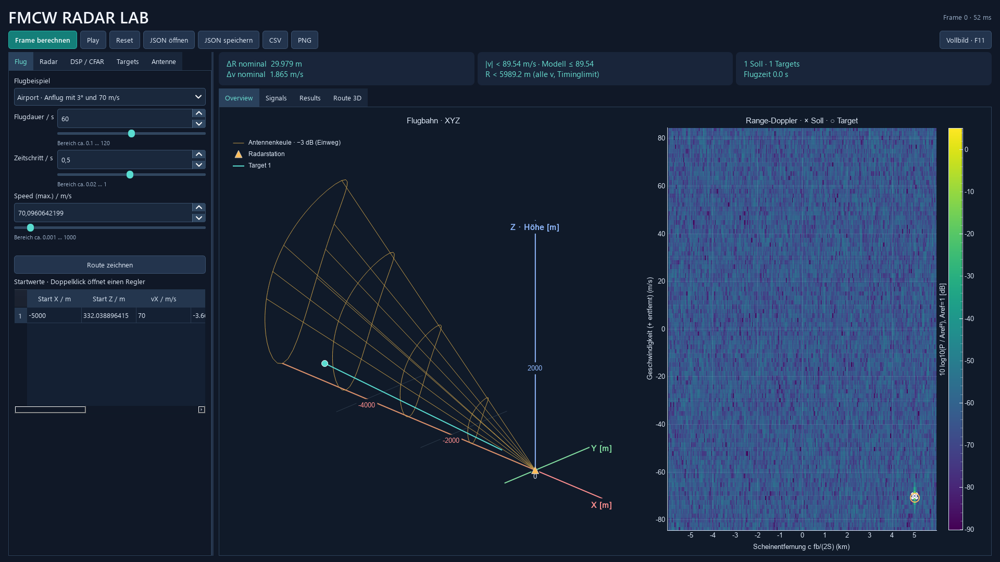
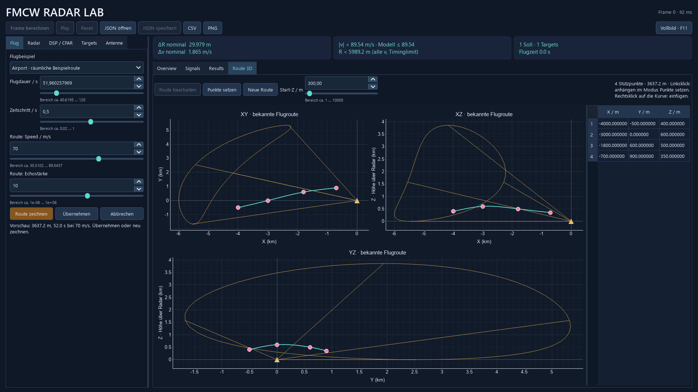

# Radar Lab · FMCW, Puls-Doppler und Passiv BETA

Ein nachvollziehbarer Radarsimulator zum Lernen und als Ingenieurportfolio: FMCW und kohärentes LFM-Puls-Doppler-Radar, passive bistatische BETA, feste oder bewegte aktive Radarplattform, komplexe Echos sowie selbst implementierte CA-CFAR. **Signalverarbeitungssimulation mit vereinfachtem Ausbreitungsmodell**, kein Hardwaredigitalzwilling.

Direkte externe Abhängigkeiten: **NumPy, PyQt6 und pyqtgraph**. Keine SciPy-, Radar-, Styling-, Plotting- oder Testframeworks. Die Flugberechnung und die lokalen Variablen der wichtigsten Radar-Rechenschritte verwenden deutsche Namen und Erklärungen. Bisherige öffentliche Python-Namen bleiben für vorhandene Beispiele bestehen. Der Rechenkern importiert kein Qt.



Ansicht „Overview“ bei 1920 × 1080 mit Flughafen-Anflug, Antennenkeule und eingeschaltetem AWGN. Kreise heißen in der Oberfläche **Targets** und markieren erkannte CFAR-Peaks; bei Rauschen sind zusätzliche Treffer möglich.

**Standard-Szene:** X-Band mit 9,3 GHz, 70 m/s Flugtempo und einem 3°-Anflug aus rund 5 km Entfernung bei zunächst 332 m Höhe über Radar. Die FMCW-Konfiguration ist eine eigene Lehrkonfiguration für den Flughafennahbereich. Sie besitzt ein späteres ADC-Messfenster, einstellbare Richtantennen und echte räumliche Flugbahnen. Hintergründe und Quellen: [Flughafen, 3D und Antennen](docs/AIRPORT_3D_ANTENNEN.md).

Eigene Routen unterstützen jetzt bis zu **256 Punkte** und Flugdauern über 120 Sekunden. Eine fehlgeschlagene Übernahme erhält den vollständigen Entwurf. Beispiel und Erklärung der bereinigten Architektur: [Lange Routen und komplexe Manöver](docs/ROUTEN_UND_CODE.md).

**Neu: bewegtes Radar und Puls-Doppler.** Unter **Flug** das Beispiel **Air-to-Air · zwei Flugzeuge, Radar fliegt mit** wählen. Die letzte Tabellenzeile beschreibt das Radarflugzeug, die andere das Echoziel. Unter **Radar → Radarverfahren** lässt sich zwischen FMCW und **Puls-Doppler · LFM + Pulskompression** wechseln. Der Wechsel lädt ein passendes Radar-Startprofil; Bahnen und Antenne bleiben erhalten. Im Pulsmodus steht das bisherige Feld „Aktiver Chirp“ für die Pulsdauer, und die Wiederholungen zählen Pulse. Es wird wirklich ein verzögerter Puls mit Matched Filter ausgewertet, keine FMCW-FFT umbenannt. Sendeblindbereich, PRI-Reichweite, Doppler-Aliasing und ADC-Raster werden berücksichtigt. Die Flugansicht zeigt bekannte Weltpositionen, die Messwerte sind relativ zur Radarplattform. [Bedienung, Formeln und Vor-/Nachteile](docs/PULS_DOPPLER.md), [tatsächlicher Messbericht](reports/PULS_UND_PLATTFORM.md).

Gespeicherte Starts: `examples/15_zwei_flugzeuge_radar.json`, `examples/16_puls_doppler_air_to_air.json`, `examples/17_puls_doppler_airport.json`. Kleine Nahbereichsbeispiele können im Sendeblindbereich des Puls-Startprofils liegen; dann ist eine andere Puls-/Radar-Konfiguration nötig. Das Pulsprofil wird bei Speed-Änderungen nicht automatisch umgestaltet; unzulässige Kombinationen werden erklärt. Bewegtes Radar mit freien Splinerouten ist noch nicht freigegeben. Die Antennenausrichtung bleibt in Weltwinkeln fest. Kein Clutter-, Flugzeuglage- oder Mehr-PRF-Modell.

**Fernbereich und Passiv BETA:** Der Wechsel **Route zeichnen** steht direkt unter den Flugbeispielen. **Fernbereich · Flugzeug bei 300 km** lädt vergleichbare aktive Startprofile; unter **Radarverfahren** zwischen FMCW und Puls wechseln. Beide messen die Szene, mit unterschiedlicher beobachteter Bandbreite und Auflösung. Die Eingabebereiche erlauben bis 10.000 km, ohne physikalische Laufzeit-, Doppler- oder Speichergrenzen auszuschalten. Der neue Tab **Radarvergleich** erklärt die wesentlichen Vor-/Nachteile. [Bedienung und Theorie](docs/FERNBEREICH_UND_PASSIV.md), [gemessene Ergebnisse](reports/FERN_UND_PASSIV.md).

**Passivradar · BETA** lädt eine eigene Demo mit festem Fremdsender und Empfänger. Unter **Passiv BETA** deren Geometrie und Direktweg-Projektion einstellen. Referenz- und Überwachungskanal werden über eine echte diskrete Kreuzambiguitätsfunktion ausgewertet. Die Karte zeigt **bistatischen Umweg** und **Wegänderungsrate**, keine monostatische Entfernung oder XYZ-Ortung. Synthetischer Breitbandsender, idealer Referenzkanal und feste Tx/Rx sind ausdrücklich BETA-Annahmen; keine FM-/DVB-Hardware-Nachbildung. Beispiele: `18_fern_puls_300km.json`, `19_fern_fmcw_300km.json`, `20_passiv_beta.json` unter `examples/`.

## Installation und Start unter Windows

Python 3.11 oder neuer verwenden. Tatsächlich geprüft wurde diese Arbeitsumgebung mit Python 3.14.7, NumPy 2.5.3, PyQt6 6.11.0 und pyqtgraph 0.14.0; ältere erlaubte Versionen wurden nicht separat getestet.

PowerShell im Projektordner:

```powershell
python -m venv .venv
.\.venv\Scripts\python.exe -m pip install -r requirements.txt
.\.venv\Scripts\python.exe -m radar_sim
```

Alternativ nach der Installation `start_windows.bat` doppelklicken oder `python main.py` verwenden. Eine Aktivierung der virtuellen Umgebung und eine Änderung der PowerShell-Ausführungsrichtlinie sind nicht notwendig. Abhängigkeiten von Qt und pyqtgraph werden von pip transitiv installiert.

Die Anwendung startet im **Vollbild**. **F11** oder der Button rechts oben wechselt zum Fenster und zurück; **Esc** verlässt das Vollbild.

```powershell
# Mit zwei Flugzeugen in entgegengesetzten Richtungen starten
.\.venv\Scripts\python.exe -m radar_sim --config examples\11_flughafen_gegenverkehr.json

# Fünf kleine Lernbeispiele, ohne GUI-Import
.\.venv\Scripts\python.exe -m radar_sim --steps

# Tests und vollständiger Messbericht mit PNGs
.\.venv\Scripts\python.exe -m unittest discover -s tests -v
.\.venv\Scripts\python.exe -m radar_sim --validate
```

Für automatischen Berichtsexport ohne sichtbares Fenster: vor dem Befehl `$env:QT_QPA_PLATFORM='offscreen'` setzen. Der Bericht liegt anschließend in [reports/VALIDATION.md](reports/VALIDATION.md), seine Rohdaten in [reports/validation.json](reports/validation.json). `--output anderer_ordner` wählt das Ausgabeverzeichnis. Der Validierungsbefehl liefert bei verletzten harten Prüfkriterien Exitcode 1.

## Bedienung

1. Unter **Flug** ein Flugbeispiel wählen oder **Route zeichnen** drücken. Flughafenbeispiele laden ein vollständiges Radarprofil. Die Tabelle enthält X, Y, Z, Geschwindigkeiten, senkrechte Beschleunigung und Echostärke. Ein Doppelklick auf eine Tabellenzelle öffnet Zahlenfeld und Slider. Tooltips erklären jede Variable. Die Tabelle lässt sich seitlich scrollen.
2. Unter **Radar** Träger, Bandbreite, Chirpdauer, Wiederholintervall, Abtastrate, ADC-Vorlauf und Chirpzahl einstellen. Unter jedem Slider steht sein aus den übrigen Werten berechneter Bereich. Die Grenzen berücksichtigen Sampling, Timing, Doppler, Speicher, CFAR und die gesamte Flugbahn. Änderungen werden nach kurzer Eingabepause geprüft. Ungültige direkte Eingaben werden orange erklärt; Berechnen und Play bleiben gesperrt, bis die Kombination passt. Andere Werte werden nicht heimlich verändert.
3. Unter **DSP / CFAR** Fenster, statische Unterdrückung, Amplitudenmodell und CFAR-Umgebung einstellen. Stärke ist relative **Leistung** im didaktischen Modell, Radarquerschnitt in m² im Radar-Modell.
4. **Frame berechnen** erstellt ein kurzes Radar-Messpaket im Hintergrund und geht danach zum nächsten Zeitpunkt. **Play** zeigt den ganzen Flug. **Pause** pausiert nach dem laufenden Paket. **Reset** setzt Flugzeit und Rauschen zurück. Am Flugende wird automatisch angehalten; erneutes Play beginnt bei null.
5. **Overview** zeigt die Flugbahn und die Range-Doppler-Map in zwei großen Diagrammen. Kreuze sind Sollwerte, orange Kreise **Targets**: Sie überschreiten die CFAR-Schwelle und sind lokale Maxima. Ein Kreis ist keine garantierte Bestätigung eines Objekts. Die Karte zeigt **Scheinentfernung** `Rapp = R + fc·v/S`. **Signals** enthält Chirps, Beat-Signal und Range-Spektrum. **Results** zeigt Sollwerte, Schätzungen, Fehler und den Abstand zur CFAR-Schwelle; hier ist die Entfernung um den Doppleranteil korrigiert. Zoomen und Verschieben bleiben zwischen Frames erhalten. Positive radiale Geschwindigkeit heißt Entfernung, negative Annäherung.
6. Unter **Antenne** zwischen isotropem Vergleich, Patch-Array, Parabol und Fächer wählen. Ausrichtung und passende Größen sind per Slider einstellbar. Die gelbe Drahtkeule zeigt die Einweg-Halbwertskeule räumlich. Sie beeinflusst die Echoamplitude; die Zeichenlänge begrenzt keine Detektionsentfernung.
7. **JSON speichern** sichert die Eingaben einschließlich Antenne und räumlicher Flugbahn. **CSV** sichert die Erkennungen des letzten Frames, die Eingabekonfiguration und Frameindex/Flugzeit. Bei einem Flug kommen bekannte XYZ-Positionen und Geschwindigkeiten in einer getrennten `.flug.csv` hinzu. **PNG** exportiert zwölf Diagramme einschließlich XY, XZ, YZ und der vier Antennendiagramme. Bestehende gleichnamige Diagramme im gewählten Ordner werden ersetzt.

Unter **Antenna Pattern → Polar** zeigt ein klassisches Polardiagramm die beiden Hauptschnitte: Azimut in Türkis, Höhe in Orange. 0° liegt oben, 180° hinten; 0 dB liegt am Außenkreis. Die dB-Untergrenze ist wählbar, die Zweiweg-Wirkung auf das Echo lässt sich gestrichelt einblenden. **Details · Schnitte und Karte** enthält die bisherigen kartesischen Plots und die Winkelkarte. Änderungen unter **Antenne** und an der Trägerfrequenz aktualisieren die Vorschau ohne Frameberechnung. Die Winkel sind relativ zur Antennenachse; die Ausrichtung wirkt in der räumlichen Flugansicht. Die volle Halbwertsbreite wird aus dem linearen Modell berechnet. Parabol und Fächer bleiben Gauß-Hauptkeulen, das Patch-Feld enthält die Nebenkeulen des idealen Arrayfaktors. Eine E-/H-Ebenenzuordnung benötigt Polarisation und wird hier nicht behauptet. [Bedienung und Formeln](docs/ANTENNENDIAGRAMME.md), [ausführbarer Prüfbericht](reports/ANTENNEN.md).

Die **XYZ-Ansicht neben Range-Doppler** zeigt die räumliche Flugbahn, aktuelle Target-Positionen, die Radarstation und die Antennenkeule. X (rot) und Y (grün) liegen am Boden, Z (blau) zeigt nach oben; Zahlen auf den Achsen stehen in Metern. **Links ziehen** dreht die Ansicht, das **Mausrad** zoomt, **rechts ziehen** verschiebt und ein **Doppelklick** setzt die Ansicht zurück. Blickwinkel und Zoom bleiben zwischen Frames erhalten. Die XYZ-Ansicht verwendet bekannte Simulationspositionen und misst keine Winkel. Zum Bearbeiten der Flugbahn weiterhin **Route 3D** verwenden.

**Speed (max.)** ist bei allen Flugszenen verfügbar. Bei den Beispielbahnen skaliert dieser Regler die Geschwindigkeiten und die Flugdauer gemeinsam; die räumliche Strecke und die Flugrichtungen bleiben erhalten. Bei Parabeln wird auch die Beschleunigung passend skaliert. Unterschiedliche Geschwindigkeiten lassen sich weiterhin in der Tabelle bearbeiten. Höhere Werte als das Sliderende können direkt eingetippt werden. Die frühere Begrenzung durch die gerade eingestellten Radarwerte entfällt: Nach einer Speed-Eingabe passt die GUI nötigenfalls Wiederholintervall, Chirpzahl, Trägerfrequenz und Bandbreite an. **Auto-Radar** zeigt die neuen Werte; die Auflösung folgt oben. Dies kann das Airport-Frequenzband verlassen und stellt dann ein anderes Radarprofil dar. Beim Zurückstellen des Tempos wird vom ursprünglichen Profil ausgegangen; manuelle Änderungen unter Radar setzen diese Ausgangsbasis neu. Geometrie-, Sampling- und Speichergrenzen gelten weiterhin. Details und Prüfergebnisse: [Speed und Ansicht](reports/SPEED_UND_ANSICHT.md).

Bei direkten Überflügen zoomt die Flugansicht auf die Route: Sie belegt ungefähr **60 % der begrenzenden Fensterdimension**. Eine lange Antennenkeule vergrößert diesen Bildausschnitt nicht mehr und kann außerhalb davon liegen. Andere Szenen zeigen weiterhin die gesamte räumliche Geometrie mit Keule und Achsen. Die Range-Doppler-Geschwindigkeitsachse richtet sich nach der maximalen Szenengeschwindigkeit mit Reserve; sie bleibt während des Flugs stabil. FFT-Bins, Nyquist-Grenzen und Doppler-Korrektur werden weiterhin aus den tatsächlichen Radarparametern berechnet.

Für die Einzelversuche unter **Flug** „Feste Targets (ohne Flugroute)“ wählen und unter **Targets** Entfernung und radiale Geschwindigkeit direkt bearbeiten. Null Targets simuliert reines Rauschen. In diesem Modus variiert die Wiedergabe weiterhin nur das Rauschen.

Die untere Text- und Statusleiste entfällt. Erklärungen stehen in den Tooltips der Eingaben und Diagramme. Über der Target-Anzeige stehen per Hover auch Modellhinweise zum letzten Frame und CFAR-Details zur Verfügung. Fehlerhafte Eingaben erscheinen weiterhin direkt oberhalb des Arbeitsbereichs. Die Pfeile rechts an den Zahlenfeldern sind weiß. Speed ist bei allen Flugszenen sichtbar; der zusätzliche Echostärkeregler erscheint beim Zeichnen oder bei einer ausgewählten eigenen Route.

Nach Eingabeänderungen beginnt die Berechnung wieder bei Flugzeit null. Diagramme, Messwertkarten und CSV gehören immer zum letzten berechneten Frame. Während der Wiedergabe bleiben Eingaben durchgehend gesperrt, statt bei jedem Frame grau und wieder hell zu werden. Tabellenzellen und Diagramme werden weiterverwendet. Die Frameberechnung verwendet `QThreadPool` mit höchstens einem Job. Der Zeitschritt ist Simulationszeit; bei langsamer Berechnung dauert die Wiedergabe länger als der dargestellte Flug.

## Flughafenbeispiele und frühere Lernversuche

| Beispiel | Bewegung |
|---|---|
| `10_flughafen_anflug.json` | 70 m/s horizontal, 3° Sinkbahn von etwa 332 auf 112 m Höhe, 5 km bis 800 m horizontaler Abstand |
| `11_flughafen_gegenverkehr.json` | Zwei Flugrichtungen mit ±70 m/s, seitlich versetzt, 450 und 650 m Höhe |
| `12_flughafen_bogen.json` | Vorgeschriebener Höhenbogen 300 → 450 → 300 m bei 70 m/s horizontal |
| `13_flughafen_route3d.json` | Räumliche Kurve mit unterschiedlichen X-, Y- und Z-Werten bei 70 m/s entlang der Strecke |

Die Profile verwenden 96 Chirps, 10 MHz TX-Bandbreite, 80 µs aktive Dauer und 90 µs Wiederholintervall. Der ADC erfasst mit 10 MHz die letzten 40 µs: 400 Samples und 5 MHz beobachtete Bandbreite. Deshalb ist die nominale Entfernungsauflösung **29,979 m**, die Geschwindigkeitsauflösung **1,865 m/s**. Die kleinere Rechenlast und die Grenzen dieses Sektormodells sind offengelegt; es ist keine Nachbildung eines kommerziellen Flughafenradars.

Die bisherigen kleinen Lehrversuche bleiben mit ihren ursprünglichen Werten erhalten:

| Beispiel | Flugbahn | Erwartetes Verhalten |
|---|---|---|
| `06_ueberflug.json` | Von x=−100 m nach +100 m, 35 m Höhe, 10 m/s | Erst Annäherung, direkt über der Station radial 0 m/s, danach Entfernung |
| `07_gegenverkehr.json` | Zwei Objekte mit +10 und −10 m/s, 35 und 60 m Höhe | Gleichzeitig entgegengesetzte Flugrichtungen; zu Beginn nähern sich beide der Station |
| `08_parabel.json` | Von x=−100 m nach +100 m; Höhe 25 → 45 → 25 m | Gleichmäßige horizontale Bewegung, vorgegebene parabelförmige Höhenänderung |

Die Parabel beschreibt ein gesteuertes Flugobjekt mit −0,4 m/s² senkrechter Beschleunigung, keine freie Wurfbewegung unter Erdschwerkraft. Das Radar schätzt Entfernung und radiale Geschwindigkeit; Höhe und horizontaler Ort sind bekannte Eingaben. Die anschauliche Herleitung steht in [FLUGBAHNEN.md](docs/FLUGBAHNEN.md).

## Eigene Route zeichnen

1. Unter **Flug** auf **Route zeichnen** klicken. **Route 3D** zeigt XY, XZ und YZ gleichzeitig. **Jeder Linksklick setzt genau einen Stützpunkt**; Ziehen erzeugt keine Punkte. Bei einem ersten XY-Punkt legt **Start-Z** die Höhe fest, danach wird die unsichtbare Koordinate vom letzten Punkt übernommen. **Neue Route** leert den Entwurf.
2. **Punkte fertig** drücken, dann rosa Griffe in allen drei Ansichten verschieben oder XYZ-Werte in der Tabelle ändern. Die unsichtbare dritte Koordinate bleibt beim Verschieben unverändert. **Punkte setzen** erlaubt weitere Klicks am Routenende. Ein **Rechtsklick auf die Kurve** fügt bei Bedarf genau einen zusätzlichen Bearbeitungspunkt ein. Es werden keine Zwischenpunkte automatisch erzeugt; maximal 256 Stützpunkte.
3. **Flugdauer** oder **Route: Speed** einstellen. Beide sind bearbeitbar und gekoppelt: Dauer = räumliche Streckenlänge / Speed. Eine längere Dauer senkt das Tempo, ein höheres Tempo verkürzt die Dauer. Die Slider zeigen die dazu passenden Radargrenzen. Zusätzlich die Echostärke einstellen.
4. **Übernehmen** drücken. Die Route wird ausgewählt und bei passenden Radarwerten der erste Frame berechnet. Eine zu lange Dauer wird vollständig angezeigt und bleibt korrigierbar. Ungültige Kombinationen werden erklärt; bei einer zu weit entfernten oder zu engen Route müssen gegebenenfalls auch Geometrie oder Radarparameter angepasst werden. **Play** bewegt das Objekt entlang der Route; **Abbrechen** verwirft den Entwurf.
5. Mit **JSON speichern** bleiben die Route, ihr Tempo, Antenne und Radarparameter erhalten. Ein räumliches Flughafenbeispiel liegt unter `examples/13_flughafen_route3d.json`; die alte ebene Route `09_gezeichnete_route.json` bleibt nutzbar.



Eine Änderung der Bandbreite kann beispielsweise eine höhere Mindestabtastrate oder einen längeren Chirp nötig machen. Die Wertebereiche gelten jeweils **bei festgehaltenen übrigen Größen**. Manche Grenzen werden von anderen Bedingungen bestimmt und ändern sich daher nicht bei jeder Bandbreitenänderung. Chirpdauer und Abtastrate wählen ganze Samplezahlen. Die Bereichsanzeige ist gerundet; Hover zeigt präzisere Grenzen und ihre Bedeutung. Details und Formeln: [Regler und Routen](docs/REGLER_UND_ROUTEN.md).

Die dB-Werte der Radarplots beziehen sich auf `Aref²=1`, **nicht auf dBm** und nicht auf das jeweilige Bildmaximum. Farbskala der Range-Doppler-Map: −90…+5 dB; sehr schwache Werte werden zur Darstellung auf −160 dB begrenzt. Das Entfernungsspektrum mittelt Leistung über Chirps vor dem Dopplerfenster. Der Chirpplot ist ein schematischer Frequenzoffset zu fc, keine GHz-Abtastung. Die Antennendiagramme haben einen eigenen Bezug: Achsenleistung `G=1` entspricht 0 dB, ohne absolute dBi. Details zeigen −60…0 dB, der Polarplot hat eine wählbare Untergrenze.

## Projektstruktur und Lesereihenfolge

Die Codeüberarbeitung trennt Eingabefelder, Ergebnisansichten und Ablaufsteuerung. Gemeinsame Helfer ersetzen wiederholte Feld-, Keulen- und Berichtsfunktionen. Der Rechenkern bleibt direkt nachvollziehbar. Prüfungen und ehrliche Umfangszahlen stehen im [Refactoring-Bericht](reports/REFACTOR.md).

Der Einstieg ist die kurze Funktion `simulate_frame` in `pipeline.py`: Sie ruft Echo-Modell, FFTs und CFAR nacheinander auf. Danach lassen sich die fünf [Lernschritte](docs/LERNSCHRITTE.md) einzeln ausführen. Die Oberfläche besteht aus gewöhnlichen Qt-Widgets; Flugfeld, Signalplots und Ergebnistabelle werden in jeweils einer eigenen, direkten Aufbau-Funktion erstellt. Mathematische Zusatzdetails zur freien Route kann man anschließend separat lesen. Der [kurze Projektüberblick](docs/AUFBAU.md) zeigt die Zusammenhänge.

| Datei | Inhalt |
|---|---|
| [flugbahn.py](radar_sim/flugbahn.py) | Gut lesbarer Einstieg: Ort, Höhe, Flugtempo und radiale Geschwindigkeit |
| [pulsradar.py](radar_sim/pulsradar.py) | Zeitlich begrenzte LFM-Pulse, verzögerter Empfang, lineare Pulskompression, Doppler-FFT |
| [fernradar.py](radar_sim/fernradar.py), [radarvergleich.py](radar_sim/radarvergleich.py) | Vergleichbare 300-km-Profile und fachlicher Vergleich in der GUI |
| [passivradar.py](radar_sim/passivradar.py), [passiv_config.py](radar_sim/passiv_config.py) | Bistatische Geometrie, zwei I/Q-Kanäle, Direktweg-Projektion und Kreuzambiguität der BETA |
| [fern_passiv_validierung.py](radar_sim/fern_passiv_validierung.py) | Tatsächliche Fernbereichs-/CAF-Messungen, Auflösungsdemo und Rauschstichprobe |
| [puls_validierung.py](radar_sim/puls_validierung.py) | Vollständige Air-to-Air-Flüge beider Verfahren, Pulsreferenzen, SNR und tatsächliche CFAR-Raten |
| [route.py](radar_sim/route.py) | Glatte gezeichnete Kurve, Bogenlänge, konstantes Tempo und Krümmungsgrenze |
| [parametergrenzen.py](radar_sim/parametergrenzen.py) | Abhängige Wertebereiche ohne GUI, mit Sample-Raster |
| [regler.py](radar_sim/regler.py) | Wiederverwendbares Zahlenfeld mit Slider, Bereich und Tooltip |
| [routen_zeichnen.py](radar_sim/routen_zeichnen.py) | Mausereignisse im Flugfeld und begrenzte Stützpunktzahl |
| [routen_editor.py](radar_sim/routen_editor.py) | Drei gekoppelte Projektionen, verschiebbare Punkte und XYZ-Tabelle |
| [antenne.py](radar_sim/antenne.py) | Normierte Richtdiagramme, Zweiweg-Wirkung und Halbwertskeule |
| [antennendiagramm.py](radar_sim/antennendiagramm.py), [antennenansicht.py](radar_sim/antennenansicht.py) | Zahlenaufbereitung ohne Qt und eigener Antenna-Pattern-Tab |
| [polardiagramm.py](radar_sim/polardiagramm.py) | Kreisförmiges dB-Raster, Winkelbeschriftung und überlagerte Hauptschnitte |
| [antennen_validierung.py](radar_sim/antennen_validierung.py) | Unabhängige Element-Summen und analytische Breitenprüfung |
| [flughafen.py](radar_sim/flughafen.py) | Neue Standardprofile mit hergeleitetem ADC-Messfenster |
| [config.py](radar_sim/config.py) | Dataclasses in SI-Einheiten, Auflösungen, Modell- und Speichergrenzen |
| [model.py](radar_sim/model.py) | Laufzeit, äquivalentes Dechirping, Doppler, Amplitude und AWGN |
| [processing.py](radar_sim/processing.py) | Fenster, Range-FFT `axis=1`, Doppler-FFT `axis=0`, Achsen und dB |
| [detection.py](radar_sim/detection.py) | Trainingsring, Integralbild, CFAR-Schwelle und 8-Nachbarschaft |
| [pipeline.py](radar_sim/pipeline.py) | Gesamte Verarbeitung in einer kurzen Funktion |
| [evaluation.py](radar_sim/evaluation.py) | Getrennte Soll-Ist-Zuordnung, kein Teil des Detektors |
| [learning_steps.py](radar_sim/learning_steps.py) | Fünf ausführbare Beispiele mit analytischen Frequenzen |
| [gui.py](radar_sim/gui.py) | Ablaufsteuerung, Hintergrundberechnung, Wiedergabe und Exporte |
| [eingabefelder.py](radar_sim/eingabefelder.py) | Parameterreiter mit Zahlenfeldern, Tabellen und Tooltips |
| [ergebnisansichten.py](radar_sim/ergebnisansichten.py) | Diagramme, Ergebnistabelle und gemeinsame Frameanzeige |
| [io.py](radar_sim/io.py) | JSON und CSV mit Standardbibliothek |
| [validation.py](radar_sim/validation.py) | Reproduzierbare Messszenarien, SNR und Fehlalarmversuch |
| [flug_validierung.py](radar_sim/flug_validierung.py) | Alle 603 Messpakete der drei Flüge und ihre Schätzfehler |
| [validiere_detektion.py](radar_sim/validiere_detektion.py) | Zusätzliche Kandidaten ohne AWGN und ein Rechteck-Gegenbeispiel |
| [report_plots.py](radar_sim/report_plots.py) | PNG-Berichtsgrafiken mit pyqtgraph |
| `examples/`, `tests/`, `docs/`, `reports/` | Gespeicherte Szenarien, unittest, Technik und gemessene Resultate |

Beispiel ohne GUI:

```python
from radar_sim import RadarConfig, Target, simulate_frame

config = RadarConfig(targets=(Target(range_m=40, velocity_mps=-5, strength=1),))
frame = simulate_frame(config, frame_index=0)
print(frame.echo.beat.shape)  # (128, 400): [Chirp, ADC-Sample]
for candidate in frame.candidates:
    print(candidate.range_m, candidate.velocity_mps)
```

## Validierung und Grenzen

Die [technische Dokumentation](docs/TECHNIK.md) leitet Signalmodell, Vorzeichen, SNR, Normierungen, CFAR und Toleranzen her. [Fünf Lernschritte](docs/LERNSCHRITTE.md) verbinden die Dateien mit kleinen analytischen Beispielen.

Im mitgelieferten Messlauf werden alle drei Flüge mit insgesamt **603 Radar-Messpaketen und 804 Zielwerten** geprüft. Kein Sollobjekt fehlt in der Zuordnung; der größte Entfernungsfehler liegt bei 0,504 m, der größte Geschwindigkeitsfehler bei 0,127 m/s. Das liegt innerhalb der dokumentierten FFT-Toleranzen. Zahlen und Kurven stehen im [Flugbericht](reports/FLUEGE.md).

Die früheren Radar-Prüfszenarien bleiben erhalten: CFAR unter reinem Rauschen mit Rechteck liefert Pfa 0,0009857 bei nominell 0,001; Hann 0,0012096. Das nahe Zielpaar bei 1,2 nominellen Entfernungszellen wird mit Hann nicht zuverlässig getrennt. Zusätzliche Erkennungen durch Nebenkeulen und Rauschen werden weiterhin ausgewiesen.

Die zusätzliche [Detektionsprüfung](reports/DETEKTION.md) kontrolliert alle drei Flüge **ohne AWGN mit Hann**: 603 Pakete, genau 804 passende Peak-Kandidaten, keine zusätzlichen oder fehlenden. Die frühere Gruppierung erzeugte auch Kreise auf Spektralflanken ohne lokales Maximum; diese Ursache ist korrigiert. FFT und Fensterantwort werden zusätzlich mit einer geschlossenen analytischen Formel geprüft.

Die [Routen- und Reglerprüfung](reports/ROUTE_UND_REGLER.md) ergänzt die bisherige freie glatte Bahn und die gegen die Kernprüfung geprüften Bereichswerte. Der neue [Airport-/3D-Bericht](reports/AIRPORT_3D.md) prüft alle Flughafenprofile mit aktiver Richtwirkung. Er weist auch fehlende Targets außerhalb der Keule aus. Tests prüfen außerdem Zweiweg-Leistung, Antennen-Nullstellen, den verzögerten ADC, räumliche Ableitungen und Mausbewegungen in allen drei Ansichten.

AWGN auszuschalten entfernt keine FFT-Nebenkeulen. Mit Rechteck und mehreren Zielen können sie echte lokale Maxima und zusätzliche Kreise bilden; dafür enthält der Bericht einen reproduzierbaren Gegenfall. Mit Rauschen sind statistische Fehlalarme normal: Pfa gilt pro geprüfter Zelle, nicht pro Frame. Bei der Standardeinstellung Pfa=10⁻⁴ und 42.560 geprüften Zellen wären unter idealen Rechteck-Rauschannahmen im Mittel 4,256 rohe CFAR-Treffer pro reinem Rauschframe zu erwarten. Die Kandidatenzahl nach Gruppierung ist davon verschieden; Hann verändert zudem die Unabhängigkeitsannahmen.

Innerhalb jedes kurzen Messpakets werden Entfernung und radiale Geschwindigkeit näherungsweise konstant gesetzt. Zwischen den Paketen wird die vollständige Flugbewegung einschließlich senkrechter Beschleunigung ausgewertet. Grenzen für Bewegung und Geschwindigkeitsänderung werden vor der Berechnung geprüft. Keine Mehrwege, RF-Frontends, Antennencharakteristik, Winkelmessung, Tracking oder ML. Die Validierung prüft das offengelegte Modell, keine reale Hardware. Maximal 1.048.576 komplexe Samplezellen und 32 feste Radar-Ziele bzw. 8 Flugobjekte. Die Arraygrenze ist keine harte Obergrenze für den gesamten Prozessspeicher.

Die angegebenen GitHub-Projekte von [danaahmadifar](https://github.com/danaahmadifar) konnten am 17.10.2026 weder per Webzugriff noch über die GitHub-API abgerufen werden. Im initial leeren Workspace lag kein Referenzcode. Eine Prüfung tatsächlicher Repository-Imports oder Abhängigkeitsdateien war deshalb nicht möglich. Architektur und Bibliotheken orientieren sich an der ausdrücklichen Stack-Vorgabe im Auftrag.
