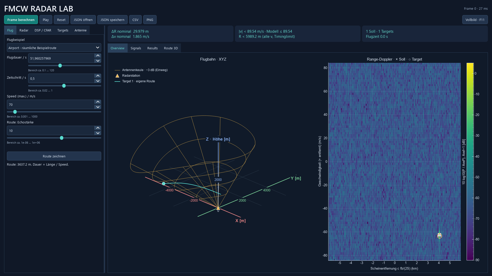

# Flughafennahbereich, 3D-Routen und Antennen

## Einordnung und Quellen

Die Anwendung startet mit einem **vereinfachten FMCW-Sektorradar im Flughafennahbereich**. Die Trägerfrequenz von 9,3 GHz ist durch reale X-Band-Flughafenradare motiviert. Beispielsweise nennt [Terma](https://www.terma.com/products/radars/surface-movement-radar/) 9,0–9,5 GHz und Fächerantennen; dessen SCANTER-System verwendet Puls-Kompression. [Indra](https://www.indracompany.com/sites/default/files/smr_en.pdf) beschreibt hingegen ein Flughafen-Bodenradar mit CW-LFM und einer Abdeckung bis 6 km. Unser Modell kombiniert diese Anregungen zu einer eigenen, transparenten Lehrkonfiguration. Es bildet keines dieser Produkte nach.

Der Standardanflug hat 70 m/s horizontales Tempo, also 252 km/h, sowie eine Sinkbahn mit 3° Neigung. Das ist eine plausible Beispielbewegung eines Flugzeugs im Anflug, kein universeller Flugzeugwert. Die [FAA](https://www.faa.gov/air_traffic/publications/aim_html/chap1_section_1.html) beschreibt 3° als üblichen Gleitpfadwinkel. Höhen sind hier **über dem Radarursprung**, keine Meereshöhen. Der Flug endet vor der Station; Landung, Startbahn, Hindernisfreiheit und Flugverfahren werden nicht simuliert.

## Die neuen Standardwerte

| Größe | Wert | Grund |
|---|---:|---|
| Träger | 9,3 GHz | X-Band als Flughafenbezug |
| TX-Bandbreite | 10 MHz | Überschaubare Speicher- und Rechenlast |
| Aktiver Chirp | 80 µs | Lineare Aufwärtsrampe |
| Wiederholintervall | 90 µs | 10 µs Pause, eindeutige radiale Geschwindigkeit bis etwa ±89,55 m/s |
| ADC | 10 MHz | Komplexes Beat-Signal, kein GHz-Träger |
| ADC-Vorlauf | 400 Samples = 40 µs | Echo aus dem betrachteten Nahbereich ist vor Aufnahmebeginn eingetroffen |
| Messfenster | letzte 40 µs = 400 Samples | Tatsächlich beobachtete Bandbreite 5 MHz |
| Chirps pro Frame | 96 | 8,64 ms Beobachtung; schnelle Ziele bleiben vom CFAR-Dopplerrand entfernt |
| Nominale Entfernungsauflösung | 29,979 m | c/(2·S·Tadc), Hann verbreitert die Hauptkeule weiter |
| Nominale Geschwindigkeitsauflösung | 1,865 m/s | λ/(2·96·Tr) |
| Referenz-SNR | 20 dB | Vor FFT, bezogen auf Echoamplitude 1 auf der Antennenachse |
| Amplitude | relative σ/R⁴-Leistung | Referenz 3000 m und 10 m², keine Watt oder dBm |
| CFAR-Pfa | 10⁻⁶ | Nominell pro geprüfter Zelle, keine garantierte Fehlalarmrate bei Hann |

Die rund 6 km ergeben sich aus Sampling und Vorlauf, nicht aus einer absoluten Radar-Leistungsbilanz. Doppler verschiebt die Mischfrequenz zusätzlich: `|2SR/c + 2v/λ| < fs/2`. Flugbewegung und radiale Beschleunigung begrenzen außerdem die Gültigkeit der kurzen, eingefrorenen Messpakete. Die Schätzauflösung ist bewusst gröber als bei manchen kommerziellen Flughafenradaren; sie wird nicht als Produktspezifikation ausgegeben.

### Warum der spätere ADC-Start nötig ist

Ein Echo mit Entfernung R kommt nach `τ=2R/c` an. Bei 5 km sind das rund 33,36 µs. Würden wir ab Rampenbeginn messen, enthielte der Anfang noch das Echo eines anderen Chirps bzw. einen Übergang. Deshalb werden die ersten 400 ADC-Schritte übersprungen. Für das verbleibende Fenster gilt `t >= τ` und damit die hergeleitete Beat-Gleichung derselben TX-Rampe.

```text
S       = B / T
t[n]    = (Nskip + n) / fs, n = 0 ... N−1
N       = fs*T − Nskip
Tadc    = T − Nskip/fs
fb      = S*2R/c + 2v/λ
ΔR      = c/(2*S*Tadc)
```

Mehr Vorlauf verkürzt das Messfenster und verschlechtert ΔR. Der Slider und die Auflösungsanzeige berücksichtigen diesen Zusammenhang. `Nskip=0` bleibt für die bisherigen kleinen Lehrszenen verfügbar: Dabei gilt weiterhin die dokumentierte Näherung `τ <= 2,5 % T` mit vernachlässigten Rampenrändern. Die alten JSON-Dateien und Kern-Standardwerte bleiben als reproduzierbare Lehrversuche bestehen; der **GUI-Start** verwendet das neue Flughafenprofil.

## Raumkoordinaten und Berechnung

Die Antenne steht im Ursprung. X und Y sind horizontal, Z ist nach oben gerichtet. Die bisherigen Namen `hoehe_m` und `geschwindigkeit_hoehe_mps` bedeuten Z und vZ.

```text
p = (x,y,z), v = (vx,vy,vz)
R = sqrt(x²+y²+z²)
v_radial = (x*vx + y*vy + z*vz) / R
```

Negativ bedeutet Annäherung. Die 3D-Position und Geschwindigkeit werden vor jedem Messpaket aus der bekannten Flugbahn berechnet. Echos, Dechirping, Range-FFT, Doppler-FFT und CFAR verwenden R und v_radial. Die Route besitzt drei Dimensionen; das Radar liefert weiterhin **Entfernung und radiale Geschwindigkeit**, keine aus Empfangskanälen gemessenen Winkel oder Höhen.

Die natürliche kubische Route wird nun gemeinsam für alle drei Koordinaten berechnet. Das Tempo bleibt entlang ihrer räumlichen Bogenlänge konstant. Derselbe Satz Stützpunkte bestimmt alle Projektionen; es gibt keine drei voneinander unabhängigen Flugbahnen. Alte `(x,z)`-Routen werden als `y=0` interpretiert. Das neue JSON-Schema ist Version 4; Versionen 1–3 bleiben lesbar.

## Räumliche Ansicht neben Range-Doppler

Overview zeigt Flugbahn, aktuelle Target-Positionen und die Antennenkeule in einer gemeinsamen XYZ-Ansicht. X und Y spannen den Boden auf, Z ist die Höhe über Radar. Alle Achsen sind in Metern beschriftet; es gibt keine künstliche Höhenüberhöhung. Links ziehen dreht, das Mausrad zoomt, rechts ziehen verschiebt und ein Doppelklick stellt den Ausgangsblick wieder her. Kamerawinkel und Zoom bleiben beim nächsten Radarframe erhalten. Die getrennten XY-, XZ- und YZ-Ansichten dienen weiterhin zum Zeichnen und Bearbeiten.

Beim direkten Überflug richtet sich der Ausschnitt nach der Route. Ihre projizierte Ausdehnung belegt rund 60 % der begrenzenden Fensterdimension. Die Keulen-Zeichenlänge bestimmt dabei den Zoom nicht mehr; entsprechend liegt ein Teil der Keule gegebenenfalls außerhalb des Ausschnitts. Der Simulator erkennt solche Überflüge daran, dass die Bodenprojektion nahe am Ursprung vorbeiführt (Zeichenreserve: 2 % der horizontalen Bahnausdehnung, mindestens 1 m). Andere Szenen zeigen die vollständige Geometrie einschließlich der Keule. Doppelklick stellt den jeweiligen Ausgangsblick wieder her. Zoomen und Drehen bleiben während einer Framefolge erhalten.

Die Darstellung ist eine **orthografische Projektion**. In `flugansicht.py` sind bei Kameraazimut a und Kameraelevation e die beiden Bildschirmvektoren:

```text
rechts = (−sin(a), cos(a), 0)
oben   = (−sin(e)cos(a), −sin(e)sin(a), cos(e))
Bildpunkt = (p · rechts, p · oben)
```

Beide Vektoren haben Länge eins und stehen senkrecht aufeinander. Auch die beiden Bildschirmrichtungen haben denselben Maßstab. Verkürzungen entstehen durch den Blickwinkel. Die Kamerawinkel ändern nur das Bild, nicht Antennenausrichtung, Bewegung oder Radarberechnung. Die Keule besteht aus Halbwertsringen und Mantellinien aus den Modellkoordinaten. Das transparente Drahtmodell verdeckt keine dahinter liegenden Linien; Bodenabschattung und perspektivische Tiefenverkleinerung werden nicht dargestellt.



## In XY, XZ und YZ zeichnen und bearbeiten

1. Unter **Flug** ein Flughafenbeispiel auswählen oder dessen JSON öffnen. Ein Flughafenbeispiel lädt das vollständige passende Profil. `13_flughafen_route3d.json` enthält einen Überflug mit 70 m/s in 600 m Höhe und einer leichten seitlichen Sinusbewegung (±100 m).
2. **Route zeichnen** drücken. Die Ansicht **Route 3D** zeigt XY, XZ und YZ gleichzeitig. Eine vorhandene eigene Route lässt sich auch dort über **Route bearbeiten** öffnen.
3. Bei einer neuen Route jeden Stützpunkt **einzeln mit links anklicken**. Es werden keine Zwischenpunkte verteilt. Für den ersten XY-Punkt legt **Start-Z** die Höhe fest; in XZ oder YZ wird die Höhe direkt gesetzt. Bei weiteren Klicks bleibt die unsichtbare Koordinate auf dem Wert des vorherigen Punkts. Man kann dabei zwischen den Projektionen wechseln.
4. **Punkte fertig** drücken. Nun einen rosa Griff in der gewünschten Projektion ziehen; die unsichtbare dritte Koordinate bleibt dabei unverändert. Die anderen Ansichten und die XYZ-Tabelle folgen sofort. **Punkte setzen** hängt weitere Punkte per Klick an, **Neue Route** leert den Entwurf.
5. Im Bearbeitungsmodus **mit rechts auf die glatte Fluglinie klicken**, um genau einen Punkt im passenden Abschnitt einzufügen. Er liegt auf der räumlichen Kurve; die unsichtbare Koordinate wird daraus berechnet. Der Klick muss höchstens 10 Pixel von der Linie entfernt sein. Nahe vorhandenen Griffen wird kein Duplikat angelegt. Die glatte Interpolation wird danach neu berechnet. Insgesamt bleiben höchstens 256 Stützpunkte zulässig.
6. Alternativ Koordinaten in der Tabelle per Doppelklick ändern. Bodenberührung, nicht endliche Werte und zu spitze Umkehr verhindern die Übernahme. Die rosa Stützpunkte und die glatte Kurve zeigen die Geometrie; die zusätzliche Radarprüfung erfolgt nach **Übernehmen**.
7. **Flugdauer oder Speed** einstellen: Beide Eingaben sind verfügbar und über Dauer = Streckenlänge / Speed gekoppelt. Die Dauer ist damit kein unabhängiger Bewegungsparameter. Längere Dauer bedeutet langsameres Fliegen auf derselben räumlichen Strecke. Die Flugdauer ist nicht auf 120 Sekunden begrenzt. Bei unzulässigen Eingaben bleibt der vollständige Entwurf offen und korrigierbar. Erst eine gültige Kombination wird übernommen und gestartet. **Übernehmen**, dann **Play**. **Abbrechen** stellt die bisherige Route und ihre Dauer-/Tempoeingaben wieder dar. JSON speichert die räumlichen Punkte. PNG exportiert acht Diagramme einschließlich XY, XZ und YZ; die `.flug.csv` enthält auch Y und vY.


## Sichtkeule und Antennentypen

Unter **Antenne** werden Typ, Azimut, Elevation und die passenden Größen eingestellt. Azimut 0° zeigt nach +X, 90° nach +Y, 180° nach −X. Elevation 0° ist horizontal. Es handelt sich um eine pro Frame fest ausgerichtete Antenne: keine automatische 360°-Abtastung und keine Verarbeitung mehrerer Empfangskanäle.

Die Keule folgt den Einstellungen als Vorschau. Heatmap und Detektionen ändern sich nach **Frame berechnen** und beziehen sich auf den zuletzt berechneten Frame. Im Standardprofil liegt die Antennenachse bei Azimut 180° und Elevation 20°, mit 12° horizontaler und 40° vertikaler Einweg-Halbwertsbreite.

| Typ | Modell | Einstellgrößen |
|---|---|---|
| Isotrop | G=1 in alle Richtungen | Vergleich ohne begrenzte Halbwertskeule |
| Phased Array / Patch-Feld | Gleichförmiger Rechteck-Arrayfaktor, d=λ/2, Elementleistung cos² nach vorn | Zeilen, Spalten und Ausrichtung |
| Parabol | Gauß-Näherung der Hauptkeule; volle Halbwertsbreite etwa 70λ/D in Grad | Durchmesser, Ausrichtung |
| Fächer | Elliptische Gauß-Hauptkeule | Azimut- und Elevationsbreite getrennt, Ausrichtung |

G ist die auf die Hauptachse normierte **Einweg-Leistung**. Alle Typen werden bei gleichem Achsenpegel verglichen, ohne absolute Gewinne, Senderleistung oder EIRP. Ein größeres Array wird schmaler, es erhöht hier nicht automatisch den absoluten Empfangspegel. Die eingestellte Ausrichtung orientiert die modellierte Apertur; es gibt kein Modell eines festen Panels mit Scanverlusten.

Für die Fächerkeule gilt in lokalen Antennenwinkeln:

```text
G(az,el) = exp(−4 ln(2) * [(az/βaz)² + (el/βel)²])
```

Für ein gleichförmiges Patch-Feld mit N Elementen je Achse gilt `AF(u)=sin(Nπu/2)/(N sin(πu/2))`, wobei u ein Richtungskosinus ist. Die beiden Arrayfaktoren werden multipliziert; ihr Betragsquadrat wird mit dem vereinfachten Patch-Elementdiagramm gewichtet. Die entstehenden Nebenkeulen sind Teil des Echo-Modells. Parabol- und Fächermodell bilden dagegen nur die Hauptkeule nach. Die [MathWorks-Dokumentation zu Element- und Arraydiagrammen](https://www.mathworks.com/help/phased/ug/element-and-array-radiation-patterns-and-responses.html) beschreibt die zugrunde liegende Trennung; [Gauß-Hauptkeulen](https://www.mathworks.com/help/radar/ref/beamloss.html) sind eine verbreitete Vereinfachung.

Der Tab **Antenna Pattern** zeigt dieselben Modelle als lokale Winkelschnitte und Winkelkarte. Das Parabolmodell verwendet den tatsächlichen Winkel zur Achse und ist damit rotationssymmetrisch. Die Halbwertsbreiten werden aus der linearen Leistung berechnet; die Muster sind auf den Achsenpegel normiert, nicht in dBi kalibriert. Bedienung, genaue Formeln, Modellgrenzen und unabhängige Prüfungen stehen unter [Antennendiagramme](ANTENNENDIAGRAMME.md).

Für dieselbe Antenne beim Senden und Empfangen gilt:

```text
Empfangsleistung ∝ σ/R⁴ * G²
Echoamplitude   ∝ sqrt(σ)/R² * G
```

Einweg-Halbwert G=0,5 bedeutet deshalb −3,01 dB Einweg, −6,02 dB Empfangsleistung und halbe Echoamplitude. Die weißen Sollkreuze bleiben auch außerhalb der Keule sichtbar; sie zeigen bekannte Eingaben. Ein Target kann außerhalb der Hauptkeule noch erkannt werden oder im Rauschen verschwinden. Die Antenne setzt keine künstliche harte Detektionsgrenze bei −3 dB.

Die gelbe Drahtkeule in Overview und in allen Raumansichten zeigt die **Projektion des Einweg-Halbwertsvolumens** bis zur eingestellten Zeichenlänge. Die Länge begrenzt keine Echoentfernung. Die Projektion ist kein Schnitt der Keule bei X=0 oder Y=0. Isotrop besitzt keine solche Halbwertsgrenze und zeigt daher keine begrenzte Keule. Feste R/v-Targets ohne Raumposition verwenden weiterhin den Achsenpegel; ihre Richtung ist nicht definiert.

## Grenzen und nachprüfbare Ergebnisse

Kein kalibriertes Antennenmodell, keine Nahfeldberechnung, keine Polarisation, Bodenreflexion, Erdkrümmung, Wetterdämpfung oder RCS-Schwankung eines ausgedehnten Flugzeugs. Die gezeichnete Keule ersetzt keine HF-Leistungsbilanz. Gerade bei großen Aperturen und kurzen Entfernungen ist die Fernfeldnäherung zusätzlich zu prüfen.

`python -m radar_sim --validate` erzeugt den [Airport-/3D-Messbericht](../reports/AIRPORT_3D.md). Er berichtet auch außerhalb der Keule fehlende Targets und zusätzliche CFAR-Peaks. Die Tests prüfen unabhängig die verzögerte Mischung, räumliche Ableitungen und das konstante Routentempo sowie Halbwertsgrenzen, Patch-Nullstellen und die Zweiweg-Leistung.
