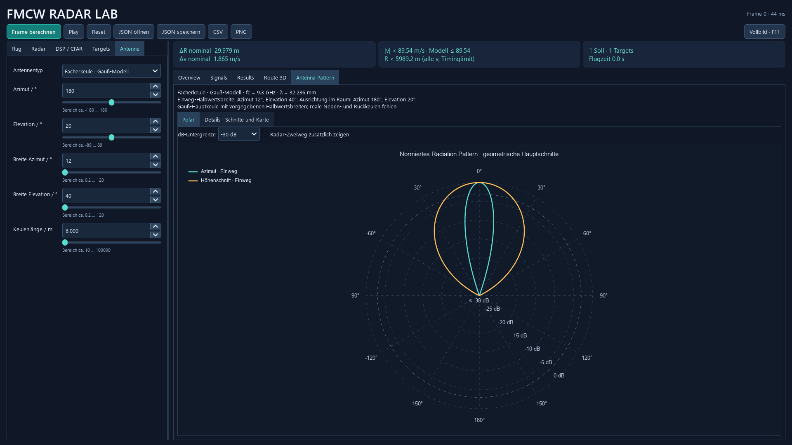
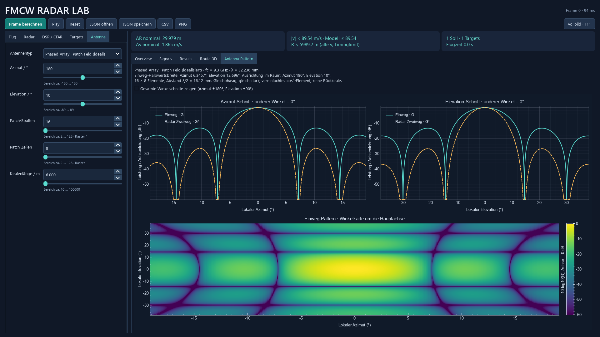

# Antenna Pattern: Berechnung und Bedienung

Rechts im Tab **Antenna Pattern → Polar** steht ein klassisches Polardiagramm mit zwei überlagerten Hauptschnitten. Links unter **Antenne** Typ, Größe und Ausrichtung wählen; die Trägerfrequenz steht unter **Radar**. Die Vorschau reagiert ohne neue Frameberechnung. **Details · Schnitte und Karte** enthält weiterhin die beiden kartesischen Schnitte und die Winkelkarte. **PNG** speichert alle vier Antennendiagramme. Die Radarplots und CSV bleiben dem letzten berechneten Frame zugeordnet.

Im Polardiagramm liegt **0° oben**, +90° rechts, −90° links und 180° unten. Türkis zeigt den Azimut-Schnitt, Orange den vertikalen Höhenschnitt. Der Außenkreis entspricht **0 dB**, die beschrifteten Innenringe schwächeren Leistungen. Die **dB-Untergrenze** ist zwischen −15, −30, −45 und −60 dB wählbar; Werte darunter liegen im Zentrum. **Radar-Zweiweg zusätzlich zeigen** ergänzt die Echo-Leistung als gestrichelte Kurven. Der etwas hellere Ring kennzeichnet den Einweg-Halbwert −3,0103 dB.

Für den Radius wird `r=(clip(10 log10(G), Untergrenze, 0)−Untergrenze)/|Untergrenze|` verwendet, danach `x=r sin(θ)`, `y=r cos(θ)`. Ein halber Radius bedeutet daher beispielsweise bei −30 dB Untergrenze einen Pegel von −15 dB, keine halbierte lineare Leistung. Der Kreis bleibt auch bei einem breiten Fenster kreisförmig. Das vollständige vertikale Diagramm nutzt einen **Umlaufwinkel** von −180° bis +180° in der Vorwärts-/Höhenebene; außerhalb ±90° zeigt es den Rückraum. Dort darf der Elevationsschnitt nicht einfach vorwärts gespiegelt werden.

Die Schnitte heißen bewusst Azimut und Höhe. Eine physikalische E-/H-Ebenenzuordnung wie in manchen Antennenveröffentlichungen benötigt zusätzlich eine definierte Polarisation; diese simuliert das Projekt nicht. Die Darstellung erzeugt keine zusätzlichen Rückkeulen, die das gewählte Antennenmodell nicht enthält.

Die Winkel sind **lokal zur Antennenachse**: Azimut 0° / Elevation 0° ist die Blickrichtung. Eine Änderung der Ausrichtung dreht die Keule im Flugfeld, verändert aber ihre lokale Form nicht. In **Details** zeigen die Plots standardmäßig einen Ausschnitt von ungefähr ±3 Halbwertsbreiten, begrenzt auf den sichtbaren Winkelbereich. **Gesamte Winkelschnitte** zeigt auch die übrigen Winkel und den Rückraum im horizontalen Schnitt. Die Karte behält den Ausschnitt um die Hauptachse. Sie ist eine Winkelkarte, keine XY-Projektion und keine Winkelschätzung aus Empfangsdaten.





## Leistung und dB-Referenz

Alle Modelle liefern dieselbe Größe `G`: die **relative Einweg-Leistung**, auf den Achsenwert 1 normiert. Im Polardiagramm zeigen durchgezogene Linien `10 log10(G)` und optionale gestrichelte Linien `10 log10(G²)`. In den kartesischen Detailplots zeigt Grün die Einweg-, Orange die Zweiweg-Leistung: Bei derselben Antenne für Senden und Empfangen wird die Echoleistung zweimal mit dem Richtdiagramm gewichtet. Die komplexe Echoamplitude wird deshalb einmal mit `G` multipliziert.

Bei `G=0,5` liegen Einweg und Zweiweg bei −3,0103 bzw. −6,0206 dB. Die gepunktete Linie zeigt den Einweg-Halbwert. Die angegebene **volle Halbwertsbreite (HPBW)** ist der Abstand zwischen beiden Hauptkeulenstellen mit `G=0,5`; sie wird aus dem linearen Modell mit Intervallhalbierung bestimmt, unabhängig vom Plot-Raster. Isotrop besitzt keine Halbwertsbreite. Die Anzeige begrenzt nur die dB-Darstellung bei −60 dB; exakte Nullstellen bleiben im Rechenkern null.

0 dB bedeutet hier Achsenpegel, **keine Verstärkung von 0 dBi**. Effizienz, Speiseleistung und absolute Empfindlichkeit sind nicht gegeben. Die Breite allein bestimmt keine kalibrierte HF-Leistungsbilanz. Die Unterscheidung zwischen Feld-, Leistungsdiagramm und absoluter Richtwirkung beschreibt die [MathWorks-Dokumentation zu Element- und Arraydiagrammen](https://www.mathworks.com/help/phased/ug/element-and-array-radiation-patterns-and-responses.html).

## Patch-Array

Das ideale Rechteckfeld liegt in der lokalen Seiten-/Höhenebene. Alle Elemente werden gleich stark und gleichphasig gespeist, Abstand `d=λ/2`, `λ=c/fc`. Mit lokalem Azimut `az` und lokaler Elevation `el` sind die Richtungskosinus:

```text
vor  = cos(el) cos(az)
seit = cos(el) sin(az)
hoch = sin(el)
AF(u,N) = sin(N π u/2) / (N sin(π u/2))
G = |AF(seit,Nh) AF(hoch,Nv)|² · max(vor,0)²
```

Im Code ersetzt `sinc(Nu/2)/sinc(u/2)` den Sinusquotienten; damit ist `AF(0,N)=1` ohne Division durch null. Die erste Array-Nullstelle im jeweiligen Hauptschnitt liegt bei `sin(θ)=2/N`. Das gewählte Elementmodell ist `cos²(θ)` im Vorderraum, null im Rückraum. Es ist **kein elektromagnetisch berechnetes Patch-Element**. Die Nebenkeulen entstehen dagegen tatsächlich aus der Überlagerung der Elemente und wirken auch auf die Echos.

Die eingestellte Ausrichtung dreht das gesamte ideale Feld. Ein festes Panel mit elektronischem Scan, Scanverlusten, gegenseitiger Kopplung, Speisenetz, Polarisation oder Frequenzabhängigkeit der Elementgeometrie wird nicht berechnet. Bei Änderung von `fc` wird `d=λ/2` erneut angenommen; das ist somit kein Frequenzdurchlauf durch dasselbe physische Array. Die lokale normierte Form bleibt bei gleicher Elementzahl gleich. Grundlage ist die [Zerlegung in Elementdiagramm und Arrayfaktor](https://www.mathworks.com/help/phased/ug/element-and-array-radiation-patterns-and-responses.html).

## Parabol- und Fächermodell

Für den kreisförmigen Reflektor wird der tatsächliche Raumwinkel zur Achse verwendet, stabil berechnet als `θ=atan2(hypot(seit,hoch),vor)`:

```text
β ≈ 70 λ/D                 [Grad, volle Einweg-Halbwertsbreite]
G = exp(−4 ln(2) (θ/β)²)   [im Vorderraum]
```

Dadurch ist die Hauptkeule rotationssymmetrisch. Die zuvor verwendete Näherung `θ²≈az²+el²` wurde für den Paraboltyp ersetzt; abseits der Hauptschnitte kann sich dessen Echopegel deshalb leicht ändern. Die [MathWorks-Beschreibung des Gauß-Reflektormodells](https://www.mathworks.com/help/satcom/ref/satcom.satellitescenario.transmitter.gaussianantenna.html) verwendet dieselbe Breiten-Näherung und Gaußform. Der Faktor 70 ist keine universelle exakte Reflektorkonstante; die reale Breite hängt unter anderem von der Aperturbelegung ab.

Die Fächerkeule verwendet dagegen die zwei frei vorgegebenen lokalen Halbwertsbreiten:

```text
G = exp(−4 ln(2) [(az/βaz)² + (el/βel)²])
```

Beide Gaußmodelle enthalten **keine realen Nebenkeulen, Nullstellen oder Rückkeulen**. Der Rückraum wird künstlich auf null gesetzt. Nur beim Array gehören die angezeigten Nebenkeulen zum berechneten Idealmodell. Eine besonders breite Gaußkeule kann bis zum Vorderraumrand über 0,5 liegen; dann ist die Halbwertsbreite dort nicht definiert und es wird keine Grenze erfunden. Die Drahtkeule wird ebenfalls nur bei vorhandener Halbwertsgrenze gezeichnet. Für einen Reflektor mit `D/λ<5` nennt die Vorschau die schwache Gültigkeit der schmalen Hauptkeulennäherung; diese Hinweisgrenze ist eine praktische Kennzeichnung, kein scharfer physikalischer Übergang.

## Validierung und Grenzen

`python -m radar_sim --validate` schreibt [antennen.json](../reports/antennen.json), [antennen.json](../reports/antennen.json) und vier Pattern-PNGs. Die Prüfung vergleicht vier Arraygrößen mit direkten komplexen Element-Summen in je 513 reproduzierbaren Raumrichtungen, auch bei gedrehter Ausrichtung. Weitere Prüfungen betreffen Hauptachsen, Symmetrie, Leistungsgrenzen, erste Nullstellen, Gauß-Halbwerte, Frequenz-/Durchmesserskalierung, rotationssymmetrische Reflektorkeulen und die tatsächliche gezeichnete G=0,5-Grenze. Separate Tests prüfen Datenform, Echo-/Plot-Konsistenz, dB-Referenz, schmale Keulen, Polarwinkel, logarithmischen Radius, den Rückraum des vertikalen Vollkreisschnitts und die GUI-Aktualisierung. Diese Prüfungen belegen die Umsetzung der definierten Modelle; sie ersetzen keine Messung einer Hardwareantenne.

Die Modelle gelten im **Fernfeld**. Die größte Aperturabmessung muss gegenüber der Wellenlänge und der betrachteten Entfernung passend sein; als Größenordnung wächst die Fernfeldentfernung mit `L²/λ`. Es gibt keine Nahfeld-, Beugungs-, Boden-, Polarisations- oder Kopplungsberechnung. Die Diagramme verwenden die Trägerfrequenz, keine zusätzliche Simulation über das gesamte Chirp-Frequenzband. Die Winkelkarte hat feste 301×401 Zellen; sehr schmale Nebenkeulen können im Raster fehlen. Dichte zusätzliche Winkelwerte in den Hauptschnitten erhalten auch bei sehr schmalen Hauptkeulen die Lesbarkeit. Alle Leistungswerte im Echo bleiben unabhängig von diesem Plot-Raster.

Die neuen Dateien sind bewusst getrennt: `antennendiagramm.py` bereitet die Zahlen ohne Qt auf, `antennenansicht.py` zeichnet sie, `antennen_validierung.py` liefert Referenzen und Bericht. Die eigentlichen Antennenformeln stehen weiterhin ausschließlich in `antenne.py`.
