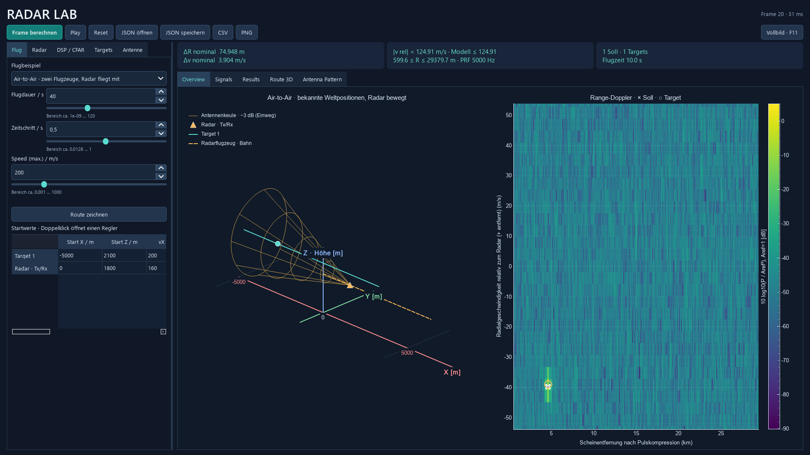
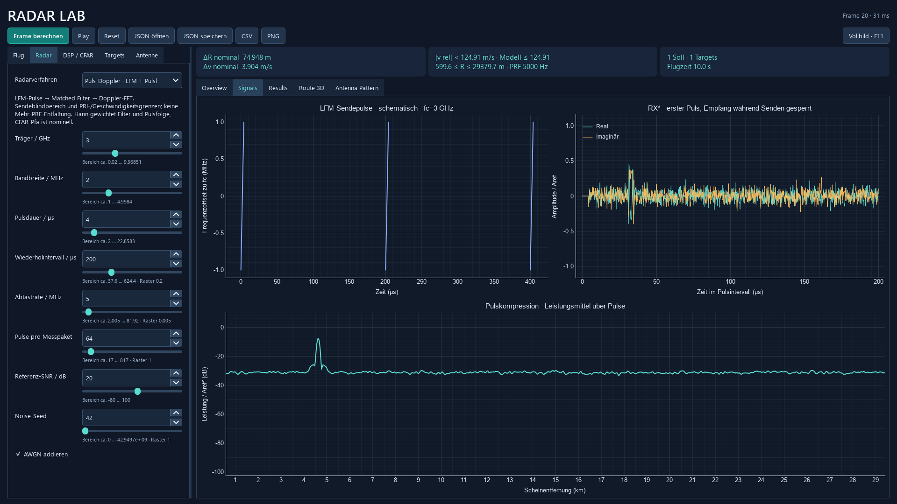

# FMCW, Puls-Doppler und bewegte Radarplattform

## Bedienung und Beispiele

Unter **Radar → Radarverfahren** zwischen FMCW und **Puls-Doppler · LFM + Pulskompression** wählen. Ein Wechsel lädt passende offene Radar-Startwerte und behält die Flugbeschreibung sowie Antenne bei. Die Werte anschließend bearbeiten und **Frame berechnen** oder **Play** wählen. Die Profile sind Lehrbeispiele, keine Daten eines kommerziellen Radars und kein Vergleich bei identischer Hardware oder Sendeenergie.

Unter **Flug** steht **Air-to-Air · zwei Flugzeuge, Radar fliegt mit**. Es gibt genau zwei Flugzeuge: Das Radarflugzeug trägt Sender und Empfänger; das andere Flugzeug ist das einzige Echoziel. In der Tabelle ist die letzte Zeile als **Radar · Tx/Rx** bezeichnet. Startpositionen und Geschwindigkeiten sind editierbar. Die Geschwindigkeitsänderung über **Speed** skaliert beide Tabellenbahnen und die Flugdauer gemeinsam. X/Y/Z sind Weltkoordinaten in Metern, Z über Boden. In Overview bewegt sich der gelbe Radar-Marker samt Antennenkeule entlang der gestrichelten Plattformbahn. Die räumlichen Positionen sind bekannt, keine Winkelmessung.

Die Antenne bleibt in Weltwinkeln ausgerichtet; es gibt kein Flugzeug-Lagemodell, keine automatische Zielnachführung und kein elektronisches Schwenken eines festen Panels. Die neue Beispielkeule blickt nach hinten zum aufholenden Target. **Null-Doppler unterdrücken** entfernt relative radiale Geschwindigkeit nahe null. Ein Bodenobjekt ist aus einem bewegten Radar im Allgemeinen kein Null-Doppler-Ziel; Bodenclutter und dessen Kompensation werden nicht simuliert.

Gespeicherte Beispiele:

| Datei | Inhalt |
|---|---|
| `15_zwei_flugzeuge_radar.json` | FMCW, Radarflugzeug 160 m/s bei 1800 m, Target 200 m/s bei 2100 m, seitlicher Versatz 300 m, Dauer 40 s |
| `16_puls_doppler_air_to_air.json` | Dieselbe räumliche Szene mit Puls-Doppler |
| `17_puls_doppler_airport.json` | Flughafenanflug mit Puls-Doppler |

JSON speichert Verfahren und Plattformbahn, CSV die Detektionen und die zugehörige Konfiguration. Bekannte Weltbewegungen stehen getrennt in `.flug.csv`; beim bewegten Radar kommt `.radar.csv` hinzu. Die Felder `entfernung_m` und `radialgeschwindigkeit_mps` der Target-Zustände sind relativ zur Radarplattform. Die zusätzlich exportierten Radar-Zustände enthalten die Weltbewegung und ihren Abstand zum Weltursprung. Sie sind kein Eigenziel.

Das Puls-Startprofil ist für Kilometerentfernungen gewählt. Kleine Überflug-Beispiele können in seinem Sendeblindbereich liegen. Das wird als unzulässige Kombination erklärt; die Simulation erfindet dafür keine empfangbaren Echos. Freie Splinerouten mit bewegtem Radar sind in dieser Version nicht freigegeben. Analytische gerade und parabelförmige Plattform-/Targetbahnen sind unterstützt. Bei fester Bodenstation bleiben die bisherigen freien Routen verfügbar. Für Pulsradar wird bei freien Routen deren kleinste Höhe als konservative Untergrenze des Abstands benutzt; dadurch können auch eigentlich ausreichend entfernte Routen abgelehnt werden.



## Relativbewegung und Vorzeichen

Für bekannte Weltpositionen `pT,pR` und Geschwindigkeiten `vT,vR` gilt:

```text
p = pT − pR                         [m]
u = vT − vR                         [m/s]
R = |p|,  v_radial = p·u/R           [m, m/s]
τ = 2R/c,  fd = 2 v_radial/λ         [s, Hz]
```

Positive radiale Geschwindigkeit bedeutet Entfernung, negative Annäherung. Beide Verfahren verwenden dieselbe Konvention. Gemeinsames zusätzliches Tempo beider Flugzeuge ändert R und Doppler nicht. Das Radarflugzeug ist kein bistatischer Sender: Sender und Empfänger bewegen sich gemeinsam auf einer Plattform.

Die relativen analytischen Bahnen sind höchstens quadratisch. Für sichere Grenzen über die ganze Szene werden Extrema von `|p+ut+at²/2|²` über die Nullstellen seiner Ableitung bestimmt. Ein zeitliches Raster könnte eine Kollision zwischen Frames übersehen. Die Plattformen müssen mindestens 1 m Abstand halten. Die bestehenden Grenzen für geringe Range-Wanderung und geringe Doppleränderung pro Messpaket werden mit Relativtempo und Relativbeschleunigung geprüft.

Innerhalb eines kurzen Messpakets werden R und radiale Geschwindigkeit eingefroren. Doppler steckt bereits in der schnellen und langsamen Signalphase und wird nicht zusätzlich durch eine wandernde Laufzeit eingebaut. Das ist eine Schmalband-/Stop-and-Hop-Näherung bei Geschwindigkeiten weit unter c; Bewegung während der Ausbreitung und relativistische Korrekturen werden nicht exakt gelöst. Sie ist kein hochgenauer bewegter Freiraumkanal. Zwischen Messpaketen folgt die Position der Flugbahn.

## Pulsmodell und Verarbeitung

Ein kohärentes Puls-Doppler-Radar muss nicht unmodulierte Pulse verwenden. Hier ist es ein Rechteck-Hüllkurvenpuls mit **linearer Frequenzmodulation (LFM)** und Trägerfrequenz fc. Die aktive Dauer steht im gemeinsamen Feld `chirp_s`, im Pulsmodus als **Pulsdauer** beschriftet. `repetition_s=Tr` ist das Pulsintervall, `chirps=M` die Zahl kohärenter Pulse. Das [MathWorks-Beispiel zur Pulskompression](https://www.mathworks.com/help/phased/ug/pulse-compression-using-phased-system-objects.html) beschreibt diese Kombination aus LFM, Matched Filter und Dopplerverarbeitung. Die Implementierung verwendet ausschließlich NumPy.

```text
S = B/Tp
s(t) = exp(j π S (t−Tp/2)²)          für 0≤t<Tp, sonst 0
rx[m,t] = A s(t−τ) exp(−j2πfcτ) exp(−j2πfd(t+mTr))
```

Der Signalträger wird nicht direkt abgetastet. Im Array steht **conj(rx)**. Dadurch ist die Dopplerphase für ein sich entfernendes Target positiv, wie bei `tx*conj(rx)` im FMCW-Modell. Der Pulsmodus führt kein FMCW-Dechirping aus. Der Signalplot heißt deshalb **RX***. Er zeigt das komplexe konjugierte Empfangssignal über das ganze PRI, bevor es komprimiert wird.

Der ADC erfasst `N=fs·Tr` ganze Werte je PRI. Während des Sendens `t<Tp` sind Empfangssignal und Rauschen gesperrt. Der modellierte Umschalter hat keine zusätzliche Erholzeit. Eine reale Umschaltung kann den Blindbereich weiter vergrößern.



1. Der Puls wird kontinuierlich um `τ` verzögert und dann abgetastet. Auch nicht ganzzahlige Sample-Laufzeiten werden berücksichtigt.
2. Mehrere Targets überlagern sich komplex. AWGN wird vor der Empfangssperre addiert; Seed und Frameindex machen es reproduzierbar.
3. Der Entfernungsfilter korreliert mit dem bekannten konjugierten Referenzpuls. Rechteck ist der Matched Filter; Hann gewichtet die Filterkoeffizienten zur Nebenkeulenminderung. Das ist bei Hann ein gewichteter, nicht der optimale AWGN-Matched-Filter.
4. Die Korrelation wird als lineare FFT-Faltung umgesetzt: genug Nullen, keine zyklischen Echos. Die bekannten Filterverzögerungen werden über den Index entfernt. Nullauffüllen dient der korrekten Faltung und verbessert keine physikalische Auflösung.
5. Eine Doppler-FFT wertet die komprimierten Pulse kohärent aus. Danach folgen dieselbe lineare 2D-CA-CFAR und Peak-Gruppierung wie bei FMCW.

Die Hüllkurve ist ideal rechteckig. Ihre Spektralränder sind nicht streng bandbegrenzt; ein reales Analogfilter wird nicht simuliert. Die Samplingprüfung `fs>B+2|fd|` betrifft den nominellen LFM-Frequenzhub mit Dopplerreserve. Mindestens acht Samples pro Puls und `B·Tp≥4` begrenzen zusätzlich grobe Lehrkonfigurationen. Das sind Rechengrenzen dieses Modells, keine universellen Radarregeln.

## Auflösung, Kopplung und eindeutige Bereiche

```text
λ = c/fc, PRF = 1/Tr
Entfernungsauflösung nominal       ΔR = c/(2B)
ADC-Laufzeitbin                    ΔRbin = c/(2fs)
Doppler-Binabstand nominal         Δv = λ/(2MTr)
Eindeutige radiale Geschwindigkeit |v| < λ/(4Tr)
Eindeutige Laufzeitentfernung       R < cTr/2
Volle Pulse empfangbar              cTp/2 ≤ R ≤ c(Tr−Tp)/2
Tastgrad                            D = Tp/Tr
```

Die untere Grenze entsteht durch die Sendesperre. Die obere praktische Grenze ist strenger als die reine PRI-Eindeutigkeit: Ein ganzes Echo muss vor dem nächsten Puls enden. Teilweise empfangbare Pulse und Echos früherer PRIs werden nicht nachgebildet; solche Konfigurationen werden abgelehnt. Mehr-PRF-Entfaltung ist nicht implementiert. Die Karten zeigen nur vollständig trainierbare CFAR-Zellen; nahe ihren Rändern können Targets trotz zulässiger Laufzeit fehlen.

Auflösung und Binabstand sind zu unterscheiden: Das Startprofil hat ΔR≈74,948 m, obwohl ADC-Bins nur ≈29,979 m auseinanderliegen. Hann verbreitert Hauptkeulen weiter. Eine scharfe rechteckige Pulsgrenze und endliches Zeit-Bandbreite-Produkt machen `c/(2B)` zu einer nominalen Auflösungsangabe, nicht zu einer Garantie für beliebige zwei Targets.

LFM-Pulse sind nicht frei von Range-Doppler-Kopplung. Mit dieser Vorzeichenkonvention liegt der Kompressionsgrat näherungsweise bei `τapp≈τ+fd/S`. Die Detektion korrigiert daher `R≈Rapp−c·fd/(2S)`. Die endliche Hüllkurve und Doppler-Mismatch können zusätzlich den Peak verformen und den Pegel reduzieren. Hintergrund zur [Mehrdeutigkeitsfunktion und den Zielkonflikten](https://www.mathworks.com/help/phased/ug/comparison-of-ambiguity-functions-for-different-wave-modulation-schemes.html). Bei FMCW ergibt sich die entsprechende Verschiebung direkt aus `fb=Sτ+fd`.

## SNR, Leistung und CFAR

`Aref=1` ist die komplexe Amplitude eines aktiven Echos vor Filterung. `Pn=10^(−SNR/10)` ist die gesamte komplexe Rauschleistung je ungesperrtem ADC-Sample; Real- und Imaginärteil erhalten je Pn/2. Das Puls-SNR bezieht sich auf einen aktiven Echoabschnitt, **nicht auf über das PRI gemittelte Leistung**. Bei gleicher Spitzenamplitude ist die mittlere Pulsleistung proportional zum Tastgrad, während ideale FMCW-Dauersendung nicht dieselben Sendepausen besitzt. Es gibt keine vorgegebene absolute Sendeleistung, Effizienz oder Rauschzahl und somit keinen belastbaren Vergleich absoluter Reichweiten.

Die Kompression wird durch die Summe der Gewichte normiert. Ein samplegenau verzögertes Echo mit Amplitude 1 und fd=0 behält den Spitzenpegel 1. Die Rauschleistung nach Filterung ist `Pn·Σw²/(Σw)²`; kohärente Dopplerverarbeitung liefert eine weitere, von ihrem Fenster abhängige Integration. Hann verändert Rauschbandbreite, Pegel und Hauptkeulenbreite.

CA-CFAR verwendet weiter `α=Ntrain(Pfa^(−1/Ntrain)−1)` im linearen Leistungsbereich und den tatsächlichen Trainingszellenring. Die unabhängigen Exponential-Rauschleistungen sind nach Pulskompression **auch bei Rechteck nicht unabhängig**, weil benachbarte Filterausgänge Eingangssamples teilen. Die eingestellte Pfa bleibt deshalb nominell. Der Bericht misst ihre tatsächliche Rate ohne nachträgliches Schönrechnen; kein kalibriertes Fehlalarmversprechen. Null-Doppler-Mittelwertabzug erzeugt weitere Abhängigkeiten.

## Wesentliche Vor- und Nachteile

| Aspekt | FMCW im Projekt | Puls-Doppler mit LFM im Projekt |
|---|---|---|
| Entfernung | Beat-Frequenz und Range-FFT | Laufzeit und Pulskompression |
| Geschwindigkeit | Kohärente Chirpfolge | Kohärente Pulsfolge |
| ADC | Abtastung der vergleichsweise niedrigen Beat-Frequenz | Abtastung der Puls-Basisbandbandbreite; oft höhere Datenrate |
| Nahbereich | Kein Puls-Sendeblindbereich; hier aber vereinfachtes Echo-/ADC-Timing | Während Senden blind; längere Pulse vergrößern Rmin |
| Auflösung | Beobachtete Bandbreite und Fenster bestimmen sie | LFM erlaubt lange energiereiche Pulse mit durch B bestimmter nominaler Auflösung |
| Energie | Dauerbetrieb kann hohe mittlere Leistung bei kleinerer Spitzenleistung erlauben | Größere Pulsenergie bei längeren Pulsen; für gleiche mittlere Leistung kann höhere Spitzenleistung nötig sein |
| Timing | Grenzen durch Chirpüberlappung und ADC-Beat-Nyquist | Zielkonflikt: größere PRI-Reichweite gegen kleinere eindeutige Geschwindigkeit |
| Kopplung | Beat enthält Laufzeit und Doppler | Kompressionspeak verschiebt sich bei Doppler, zusätzlich Filter-Mismatch |
| Hardwaregrenzen | In echt Sender-Empfänger-Leckage und Phasenrauschen relevant | In echt Umschaltung, Erholzeit und Spitzenleistung relevant |
| Was hier fehlt | Leckage-/Analog-Hardwaremodell | Reale Schalter, Verstärker und Analogfilter |

Beide Verfahren können mit Arrays Winkel messen; das wird weiterhin nicht simuliert. Der neue Modus liefert keine zusätzliche 3D-Ortung. Kein Bodenclutter, keine MTI-/STAP-Plattformkompensation, keine MTI-Filterkaskade, kein Tracking, keine RCS-Fluktuationen, keine Mehrwege und keine Entfaltung von Entfernungs- oder Dopplermehrdeutigkeiten. Ein schlichtes Pauschalurteil „Puls ist immer weiter/besser als FMCW“ wäre ohne gleiche Systemparameter falsch.

## Prüfungen und Code

`python -m unittest discover -s tests -q` prüft unter anderem verzögerte Basisband-Echos gegen eine unabhängige Formel, FFT-Kompression gegen direkte `np.correlate`, Dopplervorzeichen, ADC-Bin und Auflösung, zwei Targets in gleicher Entfernung, Blindbereich, PRI-Aliasing, Speicher, Null-Doppler, JSON und gültige Slidergrenzen. Für die Plattform kommen numerische Ableitung von R, gemeinsame Bewegung beider Flugzeuge und eine Kollision zwischen Frames hinzu. Der GUI-Test wechselt beide Modi, berechnet weitere Frames und prüft die verschobene Keule.

`python -m radar_sim --validate` erzeugt den [tatsächlichen Messbericht](../reports/PULS_UND_PLATTFORM.md), Rohdaten und PNGs. Beide Modi werden über den vollständigen Air-to-Air-Flug mit und ohne AWGN ausgewertet. Rauschfreie Rastertoleranzen sind enger als die bei Rauschen verwendete halbe nominelle Entfernungsauflösung. SNR-Sweep und CFAR-Rauschversuche werden mit ihren tatsächlichen Ausfällen und Extras berichtet.

Der Einstieg bleibt `pipeline.py`. `flugbahn.py` berechnet relative Geometrie, `pulsradar.py` enthält die Pulsform, den Empfang und die lineare Kompression. `processing.py` wählt das Verfahren, `detection.py` bestimmt Peaks und korrigiert die Kopplung. Der Rechenkern bleibt ohne Qt verwendbar. Abhängigkeiten bleiben NumPy, PyQt6 und pyqtgraph.
