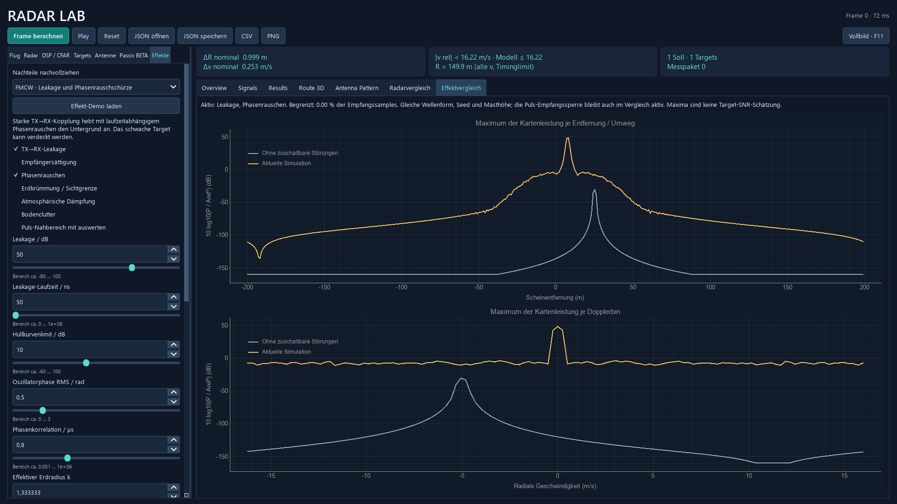
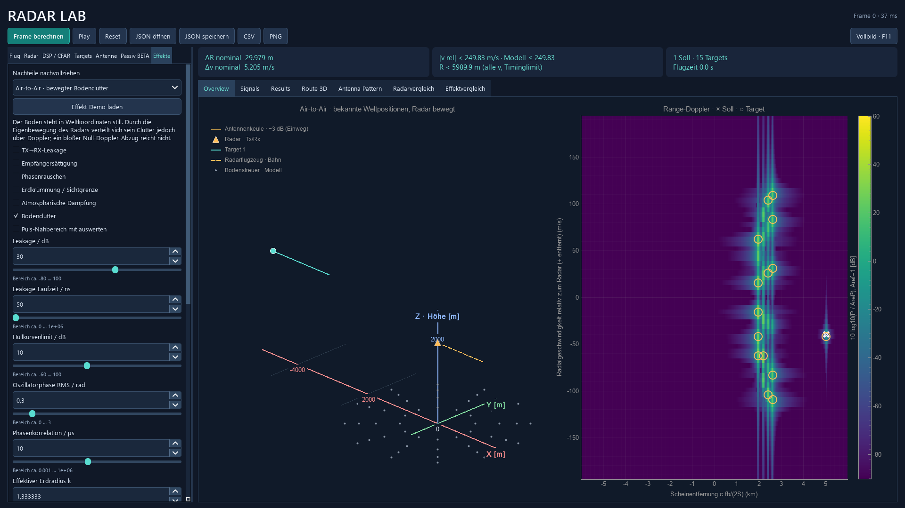

# Störeffekte und Ausbreitung

Vor dieser Erweiterung wurde der vollständige Projektstand als Git-Commit **49f4054** gesichert. Die neuen Funktionen sind einzeln abschaltbar. Die bisherigen Beispiele starten weiterhin mit ausgeschalteten Störeffekten und einer Mast-Zusatzhöhe von null.

## Bedienung und Vergleich

Links unter **Effekte** eine der neun Demos wählen und **Effekt-Demo laden** drücken. Das lädt ein vollständiges Radarprofil samt Targets, Seed und Störwerten. Anschließend lassen sich alle Werte mit Zahlenfeld und Slider ändern. Tooltips erklären Bedeutung und Einheit. Ein ungültiges Gesamtprofil sperrt die Berechnung mit einer Begründung.

Rechts unter **Vergleich → Effektvergleich** stehen die aktuelle Rechnung und eine zweite Rechnung derselben Szene ohne die sechs zuschaltbaren Störungen. Wellenform, Antenne, AWGN-Seed, SNR, Masthöhe und Puls-Empfangssperre bleiben im Vergleich gleich. Die graue Kurve ist daher kein physikalisch unmöglicher Empfänger, der während seiner eigenen Pulssendung mithört. Die berechneten Referenzdaten gehen **nicht** in CFAR oder Targetschätzung ein. Beide Rechnungen laufen im bestehenden Hintergrund-Worker. Ohne eingeschaltete Effekte entfällt die zweite Rechnung.

Gezeigt wird jeweils das Maximum der zweidimensionalen Kartenleistung pro Range-/Dopplerbin. Das erleichtert den Vergleich von Untergrund und Spitzen, ist aber keine Schätzung eines einzelnen Target-SNR. Alle Kurven verwenden dieselbe relative Referenz **10 log10(P/Aref²)** mit Aref=1. Im Pulsmodus beziehen sich Eingangspegel auf aktive Signalabschnitte, nicht auf über das PRI gemittelte Sendeleistung. Die PNG-Ausgabe enthält zusätzlich beide Vergleichsdiagramme; JSON und CSV-Begleitkonfiguration enthalten die Störeinstellungen (Schema 8, alte Dateien bleiben lesbar).

Die Soll-Targets bleiben auch bei Sichtblockierung sichtbar und zählen im Ergebnisvergleich als fehlend, wenn sie nicht erkannt werden. Bodenstreuer und Leakage sind dagegen **keine zusätzlichen Soll-Flugzeuge**. Kreise markieren lokale CFAR-Peaks: Dazu können jetzt auch unerwünschte physikalische Echos und Störanteile gehören.

Graue Punkte in der XYZ-Karte zeigen die modellierten Bodenstreuer. Starke Störpegel erhalten passende Anzeigegrenzen; die dB-Referenz bleibt unverändert. Die Skalen werden beim Ändern des Profils gesetzt und bleiben während der Wiedergabe stabil.





## 1. Kopplung zwischen Sender und Empfänger

`model.py` und `pulsradar.py` addieren einen verzögerten eigenen Sendeanteil mit Verzögerung τl und relativer Leistung Pl. Es gilt Pl=q·10^(Leakage_dB/10) und Al=sqrt(Pl), mit q=10^(TX_Peak_dB/10). Leakage/dB bezeichnet den Eingangspegel bei TX Peak 0 dB; aktive Leakage skaliert mit der Sendeleistung. Das ist **keine absolute Isolation gegenüber einer bekannten Sendeleistung**. Die Empfängerrauschleistung und das Sättigungslimit behalten ihre feste Referenz. [Sendebudget und Normierung](SENDELEISTUNG.md).

Für FMCW entsteht nach `tx·conj(rx)`:

```text
z_leak(t) = Al exp(j2π[S τl t + fc τl − S τl²/2])
```

Der Leakage-Beat ist Sτl, ohne Objekt-Doppler. Mit Phasenrauschen kommt dieselbe laufzeitabhängige Oszillator-Restphase wie bei einem Echo hinzu. Die Störung wird vor Rauschen/Begrenzung und vor jedem digitalen Filter überlagert. Daher kann auch ein Leakage-Peak außerhalb der CFAR-Randauswertung den Empfänger übersteuern. Die [FMCW-Leakage-Studie von Park et al.](https://arxiv.org/abs/1807.06324) beschreibt die zugehörige Phasenrauschen; unsere Parameter bilden keinen bestimmten Aufbau aus dieser Studie nach.

Beim Pulsradar wird ein verzögerter, zeitlich begrenzter LFM-Puls eingekoppelt. Die Sendezeit bleibt für den Empfang gesperrt. Bei τl=0 verschwindet der unmittelbare Kopplungsanteil vollständig in dieser Sperrzeit. Ein verzögerter Anteil kann über das Sendeende hinausreichen. Keine zusätzliche exponentielle Erholung, kein Mehrfachkopplungsnetz und keine gemessene Duplexerimpulsantwort werden behauptet.

Passivradar besitzt keinen eigenen Sender: Der Leakage-Schalter wird dort gesperrt. Sein Fremdsender-Direktweg ist bereits ein eigener Signalanteil unter **Passivradar**. Bei aktivierter Atmosphäre wird dessen Leistung zusätzlich um den Verlust auf Tx→Rx reduziert. Die Direktweg-dB beschreiben den relativen Eingangspegel vor dieser zusätzlichen Dämpfung.

## 2. Empfängersättigung

`empfaenger.begrenze_empfang` verwendet einen radialen Hüllkurvenbegrenzer:

```text
Amax = 10^(Limit_dB/20)
y = x min(1, Amax/|x|), bei x=0: y=0
```

Der Begrenzer erhält die Phase und komprimiert den Betrag. Er wirkt auf die **Summe** aus Targets, Clutter, Leakage/Direktweg und AWGN vor FFT, Pulskompression, Null-Doppler-Abzug und passiver Direktweg-Projektion. Er kommutiert mit einem idealen komplexen Mischer vom Betrag eins. Deshalb ist die Umsetzung am äquivalenten komplexen Empfangssignal konsistent, ohne einen GHz-Träger abzutasten.

Im passiven Modus werden beide Empfangskanäle begrenzt; ihre tatsächlichen Begrenzungsanteile werden getrennt angezeigt. Eine nachfolgende digitale Projektion kann verlorene Amplitudeninformation nicht rekonstruieren. Als Diagnose wird der Anteil der Samples mit |x|>Amax ausgegeben.

Das ist ein **gedächtnisloses Ersatzmodell**, keine vollständige LNA-/ADC-Schaltung: keine AGC, keine 1-dB-Kompressionskennlinie, keine Erholzeit, keine AM/PM-Kennlinie, keine ADC-Bitzahl und kein analoges Antialiasfilter. Insbesondere entstehen durch Nichtlinearität neue Spektralanteile; der Simulator verspricht keine unverzerrte lineare Messung bei Übersteuerung.

## 3. Kohärentes Phasenrauschen

`empfaenger.Phasenprozess` beschreibt bewusst einen glatten stationären Gauß-Phasenprozess mit

```text
E[φ(t)] = 0
Rφ(Δt) ≈ σφ² exp(−Δt²/(2Tc²))
```

Die gewählte Form lässt sich einfach prüfen und benötigt keine zusätzlichen Bibliotheken. Weißes Gaußrauschen wird per NumPy-FFT mit einem gaußförmigen spektralen Tiefpass gefärbt. Das Raster ist Tc/8; gebrochene Zeitwerte werden linear interpoliert. Der FFT-Abschnitt hat mindestens 8Tc Rand auf jeder Seite. Die Normierung gilt für die **Ensemblevarianz**; jede Realisierung künstlich auf denselben RMS-Wert zu skalieren würde ihre Statistik verfälschen.

Ein **gemeinsamer Oszillator** liefert die aktive TX- und RX-Mischerphase. Für ein Echo mit τ=2R/c bleibt beim verwendeten Mischvorzeichen

```text
δφ(t,τ) = φ(t) − φ(t−τ)
Var(δφ) ≈ 2σφ² [1−exp(−τ²/(2Tc²))]
```

Ein kurzer Kopplungsweg hebt daher viel gemeinsames Rauschen auf. Bei τ=0 ist die Restphase exakt null; bei großen Verzögerungen nähert sich die Varianz 2σφ². Alle Echos und die Leakage verwenden denselben Prozess, nicht unabhängige Phasen pro Target. Die vorhandene Dopplerphase bleibt davon getrennt und wird nicht doppelt eingesetzt.

Passiv wird stattdessen **derselbe Empfangs-LO** auf Referenz- und Überwachungskanal angewandt. Bei verzögerter Korrelation verbleibt eine zeitversetzte Phasendifferenz; beim reinen unverzögerten Direktweg hebt sie sich auf. Der Fremdsender selbst bleibt das synthetische Breitbandsignal des Passivmodells.

Die ADC-Prüfung reserviert sechs spektrale Breiten bzw. sechs RMS-Frequenzabweichungen zusätzlich zum Nutzsignal. Gaußspektren sind nicht streng bandbegrenzt: Das ist eine praktische Sicherheitsreserve, kein mathematischer Beweis von exakt null Aliasing. Maximal 262.144 Phasenrasterwerte begrenzen Speicher und Rechenzeit. Der Seed enthält die Framenummer; Frames sind unabhängige reproduzierbare Oszillator-Realisierungen, innerhalb eines Frames bleibt die Phase kohärent. Eine über Frames durchgehende PLL-Simulation wird nicht behauptet.

Dieses Modell ist **kein universelles 1/f- oder PLL-Datenblattmodell**. Für einen konkreten Oszillator wären gemessene Phasenrauschspektren und eine passende Filter-/PLL-Beschreibung erforderlich.

## 4. Erdkrümmung und Funkhorizont

`ausbreitung.py` verwendet Re=k·6.371.000 m. k=1 beschreibt die geometrische Kugel. k=4/3 ist eine verbreitete Näherung für Refraktion bei einem mittleren Brechungsindexgradienten; siehe [effektiver Erdradius](https://www.mathworks.com/help/radar/ref/effearthradius.html). Die Verwendung eines festen k modelliert keine Inversionen oder wechselnden Wetterprofile.

Die eingegebenen x/y-Werte werden als Karten-Bogenkoordinaten ab dem Ursprung interpretiert, z als Höhe über der glatten Kugel. Der zusätzliche Radar-Mast wird zur Boden- oder Plattformhöhe addiert. Mit s=hypot(x,y), θ=s/Re und q=(x,y)/s gilt:

```text
P = ((Re+z) sin(θ) qx, (Re+z) sin(θ) qy, (Re+z) cos(θ))
V = dP/dt
R = |P_target − P_rx|
v_radial = (P_target−P_rx) · (V_target−V_rx) / R
```

Die Ableitung V wird analytisch berechnet. Laufzeit, Dämpfung, Doppler und lokale Antennenrichtung verwenden diese Kugelgeometrie. Die Oberfläche zeigt weiterhin eine **schematische Karte in XYZ**, keine Erdmittelpunktkoordinaten. Ohne Erdkrümmung gelten die bisherigen kartesischen Abstände. Reine R/v-Targets besitzen keine bekannte Höhe/Richtung; Erdkrümmung und Mast benötigen deshalb eine räumliche Szene.

Die freie Sicht wird über den kleinsten Abstand des Verbindungssegments vom Kugelmittelpunkt geprüft. Schneidet es das Erdinnere, wird der direkte Echoanteil null. Eine Tangente bleibt sichtbar. Unabhängige Kontrolle: Für Höhen h1,h2 ist der Grenz-Zentralwinkel

```text
θmax = acos(Re/(Re+h1)) + acos(Re/(Re+h2))
```

Die zugehörige Bogenentfernung ist Re·θmax. Die bekannte [Tangentenentfernung zum Horizont](https://www.mathworks.com/help/radar/ref/horizonrange.html) eines einzelnen Endpunkts lautet sqrt(2Re h+h²). Bei 20 m und 1000 m Höhe ergibt das Modell rund 148,77 km Bogen-Sichtgrenze. Das 300-km-Target der niedrigen Fernbereichsdemo bleibt daher hinter dem Horizont, auch mit Puls-Doppler.

Passiv müssen **beide** Targetwege sichtbar sein. Außerdem fordert das Passivmodell freie Sicht zwischen Tx und Rx, weil ihr idealer Direktweg-Referenzkanal sonst nicht begründet wäre. Keine Beugung, Fresnelzonenprüfung, Berge, Gebäude, Mehrwege oder Überhorizontausbreitung.

## 5. Atmosphäre

Für eine vorgegebene homogene spezifische Dämpfung γ in dB/km gilt

```text
Verlust_dB = γ L/1000
Leistungsfaktor = 10^(−Verlust_dB/10)
Amplitudenfaktor = 10^(−Verlust_dB/20)
L = 2R (aktiv), L = Rt+Rr (passives Target), L = Tx−Rx-Abstand (Direktweg)
```

Der Referenzrauschpegel bleibt gleich. Dadurch sinkt das tatsächlich verfügbare Target-SNR; die Anwendung hebt es nicht heimlich wieder an. Im passiven Referenzkanal bleibt die Fremdsenderwellenform zunächst ideal auf Eins normiert, als idealer Referenzempfänger mit Pegelnormierung. Empfangs-LO und Sättigung können anschließend auch diesen Kanal beeinträchtigen.

γ ist **eine Eingabe des Szenarios**, kein automatisch aus Träger, Höhe, Temperatur, Feuchte oder Regen abgeleiteter Wert. Eine frequenzabhängige Gasdämpfung nach [ITU-R P.676](https://www.itu.int/rec/R-REC-P.676-13-202208-I) würde wesentlich mehr atmosphärische Daten und Spektrallinienmodelle benötigen und wird hier nicht behauptet. Die 300-km-Demo mit γ=0,02 dB/km dient der Weglängen-/dB-Rechnung; sie ist kein behauptetes Wetterprofil bei 300 MHz.

## 6. Bodenclutter

`bodenclutter.py` zerlegt einen festen Kreisring um den Kartenursprung in Ringe und Winkelbereiche. Jede Teilfläche A wird durch einen kohärenten Punktstreuer repräsentiert. Auf der Kugel wird die Kugelringfläche verwendet. Für die vorgegebene dimensionslose Reflektivität σ0 gilt

```text
ξ ~ CN(0,1)
σ_patch = σ0 A |ξ|²
E[σ_patch] = σ0 A
```

Das entspricht einem einfachen Rayleigh-Speckle-Modell für viele kleine Beiträge innerhalb einer Fläche. Die [normierte Oberflächen-RCS](https://www.mathworks.com/help/radar/ref/cluttersurfacercs.html) beschreibt die mittlere Streustärke pro Fläche. Hier ist σ0 konstant vorgegeben; keine konkrete Bodenart oder Frequenz-/Streifwinkelkurve wird nachgebildet. Passiv ist sie eine effektive bistatische Reflektivität, keine aus monostatischen Messungen umgerechnete Größe.

Die Streuer bleiben mit demselben Seed **an festen Weltorten und mit festen komplexen Streukoeffizienten**. Innerhalb eines Frames werden sie wie die Nutz-Targets eingefroren. Zwischen Frames folgen ihre Laufwege der Radarbewegung. Die monostatische Leistung fällt mit σ_patch/R⁴, die bistatische mit σ_patch/(Rt²Rr²), jeweils mit Antennen- und optionalen Ausbreitungsfaktoren. Diese Entfernungsabhängigkeit gilt für Bodenclutter auch im didaktischen Target-Amplitudenmodus.

Bei festem Radar liegt statischer Bodenclutter bei Null-Doppler. Bei bewegtem Radar gilt stattdessen v_radial=−u·v_radar. Unterschiedliche Richtungen erzeugen deshalb ein Dopplerband. Es wird nicht pauschal jeder Bodenstreuer auf Null-Doppler gesetzt. Laufzeit, ADC, Doppler und die Veränderung innerhalb eines Messpakets werden geprüft; unpassende Flächen werden nicht heimlich in gültige Bins gefaltet.

Ein Punkt je Fläche ist eine **grobe Quadratur**. Zu wenige Streuer zeigen einzelne Peaks statt eines glatten Untergrunds. Feinere Unterteilung verbessert die räumliche Stichprobe, ist aber keine physikalische neue Auflösung. Maximal 128 Flächen und eine zusätzliche Arbeitsgrenze begrenzen den Aufwand. Keine Vegetationsbewegung, Landkarte, volumetrischer Regenclutter, Mehrwege oder STAP-Kompensation. Der vorhandene Null-Doppler-Abzug hilft beim festen Radar, entfernt aber auch langsame Nutzsignale und löst das Problem bewegten Clutters nicht allgemein.

## Puls-Nahbereich: keine falsche harte Echo-Null

Die Sendezeit bleibt stets empfangsgesperrt. Optional darf der Matched Filter auch Verzögerungen τ<Tp auswerten. Für einen Rechteckpuls mit τ>0 bleiben bei stationärem Target rund τ/Tp der Pulsdauer nach dem Sendeende übrig. Bei ganzzahligem Sampling, ohne Doppler, mit Rechteckgewichtung ergibt sich am richtigen Lag

```text
Peakamplitude / Vollpuls = τ/Tp
Peakleistung / Vollpuls = (τ/Tp)²
```

τ=Tp/2 liefert daher −6,0206 dB Peakleistung. Ein starker Teilpuls kann weiterhin erkannt werden; cTp/2 ist die Grenze für **vollständigen** Empfang in diesem Modell, kein universeller Beweis von exakt null Signal darunter. Die Demos vergleichen 12 µs und 4 µs bei derselben Bandbreite und nahezu 900 m Entfernung. Die separate binzentrierte Prüfung verwendet exakt 30 Samples Verzögerung. Hann und Doppler ändern den Peak zusätzlich. Ohne die Option bleibt der bisherige Modus mit nur vollständigen Pulsen bestehen.

## Nachweise und Dateien

- `python -m unittest tests.test_effekte tests.test_gui_effekte -v`: Mischpegel/-frequenz, Sendesperre, Hüllkurve, Phase/Kovarianz, analytischer Horizont, Kugel-Ableitungen, beide atmosphärischen Wege, Teilpulse, Speckle-Mittelwert, Clutter-Doppler, Seed/JSON und GUI.
- `python -m radar_sim --effects`: gezielter Modellbericht und neun PNGs.
- `python -m radar_sim --validate`: zusätzlich alle bisherigen Validierungen.
- [Gemessene Ergebnisse](../reports/STOEREFFEKTE.md), Rohwerte `reports/stoereffekte.json`, Startkonfigurationen `examples/21_…json` bis `29_…json`.

Die Tests prüfen die angegebenen Gleichungen und Ersatzmodelle. Eine erfolgreiche Prüfung bedeutet keine Übereinstimmung mit beliebiger realer Radarhardware oder jeder Wettersituation. Der Simulator bleibt ein Signalverarbeitungsprojekt mit offengelegten Grenzen.
