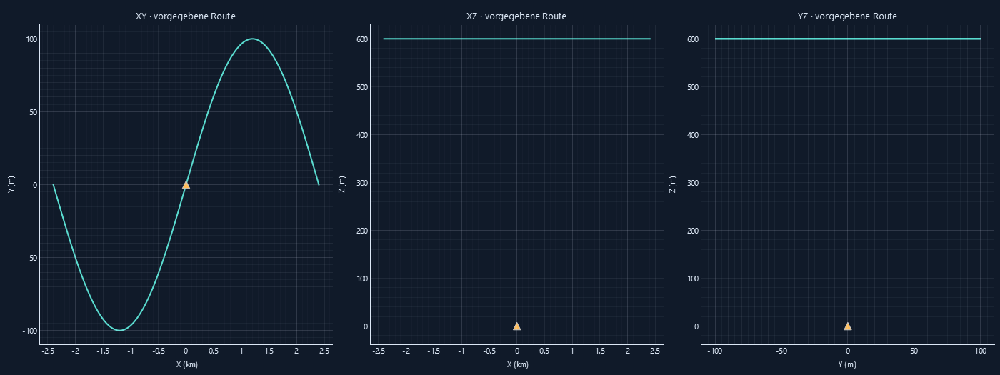

# Flughafen, Raumbewegung und Antennenkeule

Reproduzieren: `python -m radar_sim --validate`. Seed 42, AWGN eingeschaltet, relative RCS- und Entfernungsabhängigkeit, Antennenwirkung aktiv.

| Szene | Frames | Sollwerte | Fehlend gesamt | Davon in Halbwertskeule | Extra Targets | max. ΔR abs. / m | max. Δv abs. / m/s |
|---|---:|---:|---:|---:|---:|---:|---:|
| 10_flughafen_anflug | 121 | 121 | 0 | 0 | 4 | 14.894295 | 0.928821 |
| 11_flughafen_gegenverkehr | 121 | 242 | 0 | 0 | 3 | 14.945924 | 0.921076 |
| 12_flughafen_bogen | 121 | 121 | 13 | 0 | 4 | 14.843142 | 0.923312 |
| 13_flughafen_route3d | 139 | 139 | 69 | 0 | 4 | 15.019844 | 0.924281 |
| 15_zwei_flugzeuge_radar | 81 | 81 | 0 | 0 | 4 | 14.845141 | 0.681385 |

3D-Referenz: R=||p|| und v_radial=p·v/||p||; zusätzlich Ableitung der Entfernung mit dt=0,1 ms geprüft.
FFT-Toleranz: 1,01·(ΔR/2 + fc/S·Δv/2) und 1,01·Δv/2. Keine Peak-Interpolation.
Ausfälle außerhalb der Einweg-Halbwertskeule sind im Gesamtwert enthalten und kein harter Fehler. Der Höhenbogen verlässt den fest ausgerichteten Sektor; ein Vorbeiflug muss daher nicht bis zum Ende sichtbar sein.
Normierte Einweg-Leistung G wird als Amplitudenfaktor verwendet: monostatische Echoleistung proportional G². Keulenlänge ist ausschließlich eine Zeichenhilfe.
Die neuen Unit-Tests prüfen außerdem verzögerte Echo-Mischung im ADC-Fenster, Halbwertsgrenzen aller drei Richtantennen, Patch-Nullstelle, Zweiweg-Leistung und Gleichheit der Echos bei veränderter Zeichenlänge.

Gesamtergebnis: **BESTANDEN**. Rohwerte: [airport_3d.json](airport_3d.json).
