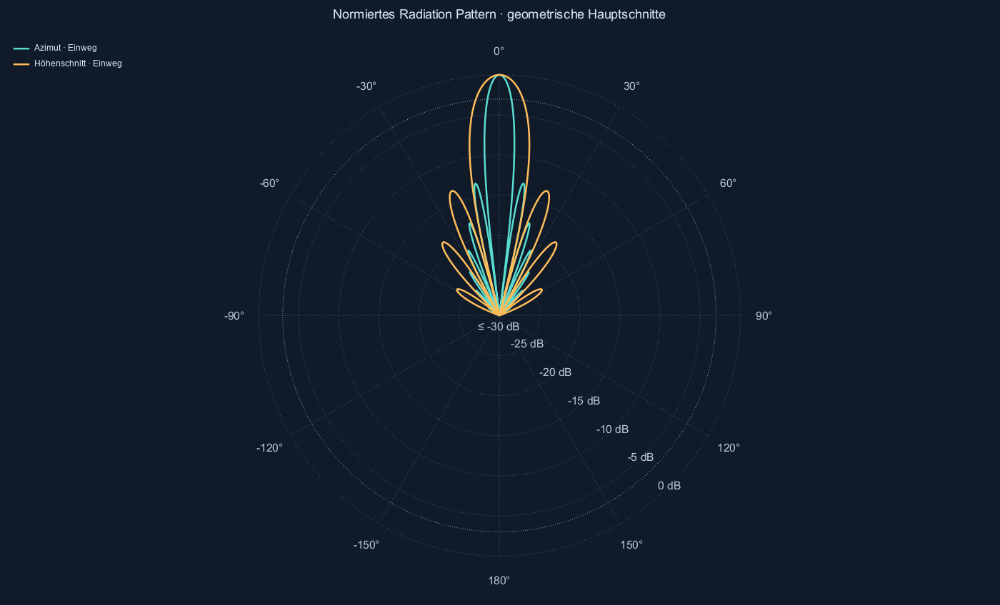
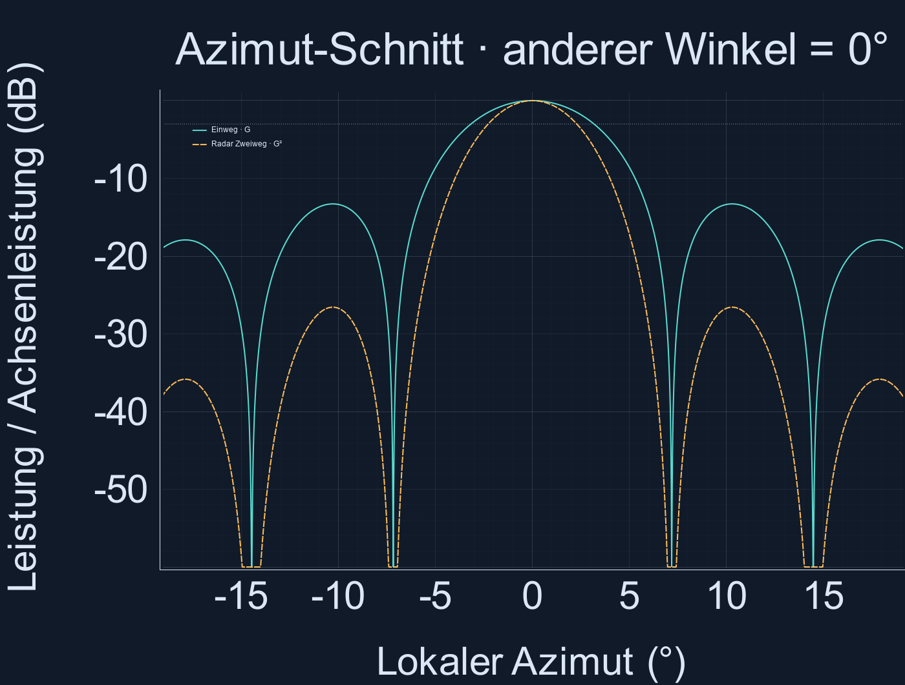
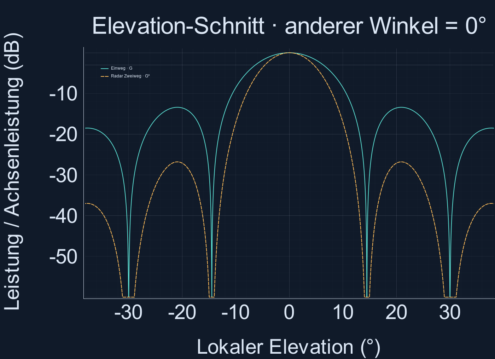
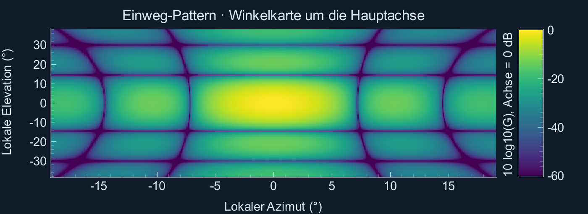

# Prüfung der Antennendiagramme

Reproduzieren: `python -m radar_sim --validate`. Seed 20261019.

Geprüft wird die mathematische Umsetzung idealisierter Fernfeldmodelle, keine gemessene Hardwareantenne.
Array: Vergleich gegen direkte komplexe Element-Summen in 513 zufälligen Raumrichtungen je Arraygröße, einschließlich Rückraum und gedrehter Antennenbasis.
Gauß: analytische Halbwertsbreiten, Viertelwert in beiden Halbwinkeln; Parabol: Frequenz- und Durchmesserskalierung. Absolute Fehlertoleranzen betreffen lineare normierte Leistung, bei Breiten Grad.

| Prüfung | Max. absoluter Fehler | Toleranz | Ergebnis |
|---|---:|---:|---|
| Array 2×2: 513 Richtungen gegen Element-Summen, gedreht | 6.66134e-16 | 2e-13 | OK |
| Array 2×2: erste Nullstelle Az | 1.4058e-65 | 1e-25 | OK |
| Array 2×2: Halbwert Az | 1.77636e-15 | 2e-12 | OK |
| Array 2×2: erste Nullstelle El | 1.4058e-65 | 1e-25 | OK |
| Array 2×2: Halbwert El | 1.77636e-15 | 2e-12 | OK |
| Array 3×5: 513 Richtungen gegen Element-Summen, gedreht | 4.44089e-16 | 2e-13 | OK |
| Array 3×5: erste Nullstelle Az | 1.23437e-33 | 1e-25 | OK |
| Array 3×5: Halbwert Az | 2.39808e-14 | 2e-12 | OK |
| Array 3×5: erste Nullstelle El | 1.45856e-33 | 1e-25 | OK |
| Array 3×5: Halbwert El | 9.99201e-16 | 2e-12 | OK |
| Array 16×8: 513 Richtungen gegen Element-Summen, gedreht | 1.63064e-16 | 2e-13 | OK |
| Array 16×8: erste Nullstelle Az | 1.5152e-33 | 1e-25 | OK |
| Array 16×8: Halbwert Az | 8.04912e-15 | 2e-12 | OK |
| Array 16×8: erste Nullstelle El | 1.50015e-33 | 1e-25 | OK |
| Array 16×8: Halbwert El | 8.04912e-15 | 2e-12 | OK |
| Array 128×127: 513 Richtungen gegen Element-Summen, gedreht | 2.52755e-18 | 2e-13 | OK |
| Array 128×127: erste Nullstelle Az | 1.51951e-33 | 1e-25 | OK |
| Array 128×127: Halbwert Az | 1.42664e-14 | 2e-12 | OK |
| Array 128×127: erste Nullstelle El | 1.51951e-33 | 1e-25 | OK |
| Array 128×127: Halbwert El | 2.20379e-14 | 2e-12 | OK |
| Gauß 0.2°×0.4°: Breite Az | 1.2475e-12 | 1e-10 | OK |
| Gauß 0.2°×0.4°: Breite El | 6.29496e-14 | 1e-10 | OK |
| Gauß 0.2°×0.4°: diagonaler Viertelwert | 5.55112e-17 | 2e-14 | OK |
| Gauß 12°×40°: Breite Az | 6.75016e-13 | 1e-10 | OK |
| Gauß 12°×40°: Breite El | 1.36424e-12 | 1e-10 | OK |
| Gauß 12°×40°: diagonaler Viertelwert | 5.55112e-17 | 2e-14 | OK |
| Gauß 120°×120°: Breite Az | 9.66338e-13 | 1e-10 | OK |
| Gauß 120°×120°: Breite El | 9.66338e-13 | 1e-10 | OK |
| Gauß 120°×120°: diagonaler Viertelwert | 5.55112e-17 | 2e-14 | OK |
| Parabol-Gauß 2.7 GHz / 0.05 m: β=70λ/D | 4.54747e-13 | 1e-10 | OK |
| Parabol 2.7 GHz: rotationssymmetrischer Halbwertskreis | 3.33067e-16 | 2e-11 | OK |
| Parabol 2.7 GHz: gezeichnete Halbwertskeule | 2.33147e-15 | 2e-08 | OK |
| Parabol-Gauß 9.3 GHz / 0.6 m: β=70λ/D | 5.05374e-13 | 1e-10 | OK |
| Parabol 9.3 GHz: rotationssymmetrischer Halbwertskreis | 6.10623e-16 | 2e-11 | OK |
| Parabol 9.3 GHz: gezeichnete Halbwertskeule | 9.40359e-14 | 2e-08 | OK |
| Parabol-Gauß 77 GHz / 1.2 m: β=70λ/D | 2.6798e-13 | 1e-10 | OK |
| Parabol 77 GHz: rotationssymmetrischer Halbwertskreis | 7.99361e-15 | 2e-11 | OK |
| Parabol 77 GHz: gezeichnete Halbwertskeule | 8.31002e-13 | 2e-08 | OK |
| Parabol-Gauß 300 GHz / 10 m: β=70λ/D | 2.39534e-12 | 1e-10 | OK |
| Parabol 300 GHz: rotationssymmetrischer Halbwertskreis | 4.02955e-13 | 2e-11 | OK |
| Parabol 300 GHz: gezeichnete Halbwertskeule | 2.37855e-10 | 2e-08 | OK |
| isotrop: Achsennormierung | 0 | 1e-14 | OK |
| isotrop: Spiegelsymmetrie | 0 | 1e-13 | OK |
| isotrop: Leistungsbereich [0,1] | 0 | 0 | OK |
| faecher: Achsennormierung | 0 | 1e-14 | OK |
| faecher: Spiegelsymmetrie | 3.33067e-15 | 1e-13 | OK |
| faecher: Leistungsbereich [0,1] | 0 | 0 | OK |
| faecher: räumliche Keule entspricht G=0,5 | 1.35225e-13 | 2e-07 | OK |
| parabol: Achsennormierung | 0 | 1e-14 | OK |
| parabol: Spiegelsymmetrie | 1.07692e-14 | 1e-13 | OK |
| parabol: Leistungsbereich [0,1] | 0 | 0 | OK |
| parabol: räumliche Keule entspricht G=0,5 | 9.60343e-14 | 2e-07 | OK |
| patch_array: Achsennormierung | 0 | 1e-14 | OK |
| patch_array: Spiegelsymmetrie | 6.66134e-15 | 1e-13 | OK |
| patch_array: Leistungsbereich [0,1] | 0 | 0 | OK |
| patch_array: räumliche Keule entspricht G=0,5 | 2.4919e-13 | 2e-07 | OK |
| Extrem breite Gaußkeule: keine erfundene Halbwertsgrenze | 0 | 0 | OK |
| Isotrop: keine Halbwertsbreite | 0 | 0 | OK |

Gesamtergebnis: **BESTANDEN**.

## Berechnete Beispiele bei 9,3 GHz

λ = 32,2357 mm. Patch: 16×8 Elemente, d=λ/2; Parabol: D=0,6 m; Fächer: Vorgabe 12°×40°.

| Modell | Volle HPBW Azimut / ° | Volle HPBW Elevation / ° |
|---|---:|---:|
| isotrop | nicht definiert | nicht definiert |
| patch_array | 6.3456588 | 12.696457 |
| parabol | 3.7608373 | 3.7608373 |
| faecher | 12 | 40 |

Die PNGs zeigen das 16×8-Array bei 9,3 GHz; Bezug ist der Einweg-Achsenpegel G=1, kein absoluter Gewinn in dBi.
Polar: 0° oben, 0 dB am Außenkreis, −30 dB im Zentrum; geometrische Hauptschnitte, ohne E-/H-Polarisationszuordnung.

Die Gaußform ist eine Hauptkeulennäherung. Reale Parabol-Nebenkeulen, Patch-Geometrie, Kopplung, Polarisation und Verluste werden nicht vorhergesagt.
Herleitung, Grenzen und Quellen: [Antennendiagramme](../docs/ANTENNENDIAGRAMME.md).
