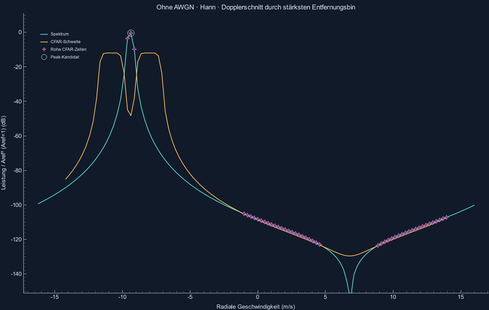

# Prüfung zusätzlicher Radar-Kreise

Reproduzieren: `python -m radar_sim --validate`.

## Gefundener Fehler und Korrektur

Die frühere Gruppierung machte aus jeder zusammenhängenden CFAR-Trefferfläche einen Kreis, auch wenn dort kein lokales Maximum lag. Im ersten Überflug ohne AWGN entstanden dadurch fünf Kreise: ein Ziel und vier Flankenkandidaten bei etwa −105 bis −121 dB relativ zur Einheitsleistung.

Jetzt muss ein Kandidat die CFAR-Schwelle überschreiten UND ein lokales Maximum gegenüber allen acht Nachbarn im vollständigen Leistungsbild sein. Die Nachbarn müssen selbst keine CFAR-Treffer sein. Zusammenhängende Bereiche ohne qualifizierten Peak erhalten keinen Kreis. Die reine CFAR-Maske bleibt unverändert zugänglich; keine Sollwerte oder vorgegebene Zielanzahl steuern die Auswahl.

## Gemessene Flüge ohne AWGN, Hann-Fenster

| Szene | Messpakete | Rohe CFAR-Zellen gesamt | Peak-Kandidaten gesamt | Zugeordnet | Zusätzliche | Fehlende |
|---|---:|---:|---:|---:|---:|---:|
| 06_ueberflug | 201 | 18271 | 201 | 201 | 0 | 0 |
| 07_gegenverkehr | 201 | 24172 | 402 | 402 | 0 | 0 |
| 08_parabel | 201 | 17428 | 201 | 201 | 0 | 0 |

Diese Prüfung ist eine Regression für die drei konkreten Szenen, keine allgemeine Null-Fehlalarm-Garantie.

## Warum AWGN ausschalten allein nicht genügt

Eine endliche Beobachtungsdauer verteilt einen nicht genau auf der FFT-Zelle liegenden Ton auf benachbarte Zellen. Die Fensterantwort hat Haupt- und Nebenkeulen. Diese verschwinden beim Ausschalten des Rauschens nicht. CA-CFAR schätzt einen Hintergrundpegel, hat aber kein Wissen über die Zahl realer Objekte. Die Pfa-Formel setzt unabhängige exponentielle Rauschleistungen voraus; im rein deterministischen, rauschfreien Spektrum gilt diese statistische Interpretation nicht.

Rechteck-Gegenbeispiel: Gegenverkehr, Frame 66 bei 6.6 s. 3 lokale Peak-Kandidaten bei 2 Sollobjekten, davon 1 zusätzlich. Hier bilden die stärkeren Rechteck-Nebenkeulen selbst lokale Maxima. Die Peak-Prüfung allein kann solche signalbedingten Geisterpeaks nicht grundsätzlich ausschließen.

Mit AWGN gibt es zusätzlich statistische Fehlalarme. Pfa bezieht sich auf eine geprüfte Zelle, nicht auf den ganzen Frame und nicht auf die Kandidaten nach Gruppierung. Die Fehlalarmmessung in VALIDATION.md zählt weiterhin die rohe CFAR-Maske.

Die Grafik zeigt einen Dopplerschnitt durch den stärksten Entfernungsbin des ersten rauschfreien Überflugs. Punkte kennzeichnen rohe Schwellenüberschreitungen; ein Kreis verlangt zusätzlich ein lokales Maximum im gesamten 2D-Bild. Die Leistung und die Schwelle sind auf Aref²=1 bezogen. Zur Darstellung unter −160 dB abgeschnitten.

## Abgleich mit der Theorie

- Die Tests vergleichen das 2D-Spektrum eines Tons zwischen den FFT-Bins mit der geschlossenen Formel der endlichen geometrischen Reihe, für Rechteck und periodisches Hann. Kein FFT-Aufruf wird zur Referenzberechnung verwendet.
- Der verzögerte Empfangschirp stimmt mit dem äquivalenten Beat-Modell überein; Laufzeit, Mischreihenfolge, Dopplervorzeichen und Kopplung bleiben unverändert.
- Die CFAR-Schwelle wird gegen eine direkte Trainingsring-Summe geprüft. Die statistische Fehlalarmprüfung bleibt von der Peak-Gruppierung getrennt.
- Ein 80 dB schwächeres, isoliertes Testziel bleibt detektierbar. Es wurde keine globale Anzeige-Pegelgrenze eingeführt, um schwache Kreise zu verstecken.

Primärquellen: [MathWorks: CFAR-Annahmen](https://www.mathworks.com/help/phased/ug/constant-false-alarm-rate-cfar-detectors.html), [TI: Radar Hardware Accelerator User's Guide, Abschnitt 2.3.2](https://www.ti.com/lit/ug/swru526b/swru526b.pdf), [MathWorks: FFT und spektrale Leakage](https://www.mathworks.com/help/signal/ug/time-frequency-analysis-using-fft.html). TI beschreibt die Nachbarprüfung für 1D; hier wird sie ausdrücklich auf alle acht Nachbarn des 2D-Leistungsbildes angewendet.

Gesamtergebnis der Hann-Regression: **BESTANDEN**.
