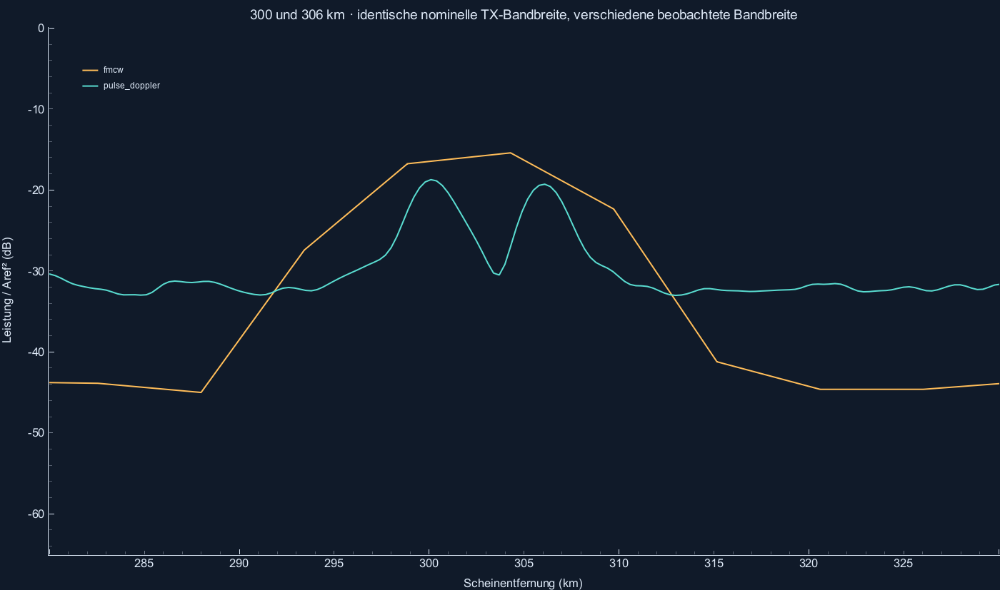
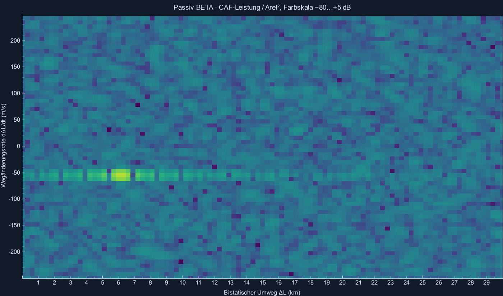

# Fernbereich und Passivradar BETA

Reproduzieren: `python -m radar_sim --validate`.

Beide Fernprofile: fc=300 MHz, B=100 kHz, fs=500 kSamples/s, Tr=3 ms, M=64, Referenz 100 km / 10 m² und SNR=20 dB pro aktivem Sample. Keine gleiche mittlere Sendeleistung oder identische Hardware behauptet.

| Verfahren | Beobachtete Bandbreite / Hz | Nominale ΔR / m | Raster / m | Eindeutiger Betrag v / m/s | Ergebnis |
|---|---:|---:|---:|---:|---|
| fmcw | 27586.2 | 5433.74 | 5433.74 | 83.2757 | OK |
| pulse_doppler | 100000 | 1498.96 | 299.792 | 83.2757 | OK |

Je drei Frames: Start, Mitte, Ende des 300-km-Flugs. Rauschfreie Halb-Bin-Toleranzen plus Dopplerkorrektur; konkrete Werte und Extras in der JSON-Datei.
FMCW ist ebenfalls fernbereichsfähig. Der Unterschied hier entsteht aus der verkürzten beobachteten Bandbreite und dem Puls-PRI-Zielkonflikt, nicht aus einer künstlich bevorzugten Radarart.

## Zwei Targets, Abstand 6 km

| Verfahren | Soll | Zugeordnet | Schätzwerte R / m |
|---|---:|---:|---|
| fmcw | 2 | 1 | [304719.5158188489] |
| pulse_doppler | 2 | 2 | [300099.6671984974, 306095.5163584974] |

Diese Hann-Auflösungsdemo wird gemessen, nicht als universelle harte Trennungsprüfung gewertet.

## Passive BETA

Fester Sender bei (−20 km,0,0), fester Empfänger im Ursprung. 600 MHz Träger, 400 kHz synthetisches Breitband, fs=1 MHz, 64 ms Integration. Ideal synchroner, rauschfreier Referenzkanal. CFAR benutzt keine Sollwerte.

| Frame | Umweg / m | Wegänderungsrate / m/s | Zugeordnet | Extra | Fehler Umweg / m | Fehler Rate / m/s | Ergebnis |
|---:|---:|---:|---:|---:|---:|---:|---|
| 0 | 6151.57 | -55.2638 | 1 | 0 | 144.07519497247813 | 0.614169978112642 | OK |
| 10 | 5878.67 | -53.896 | 1 | 0 | 117.18003240752114 | -0.7536644074705663 | OK |
| 20 | 5612.6 | -52.5341 | 1 | 0 | 83.46024784646033 | -2.1155376339640313 | OK |
| 30 | 5353.32 | -51.179 | 1 | 0 | 42.94761653462592 | -3.470692482358011 | OK |
| 40 | 5100.79 | -49.8311 | 1 | 0 | -4.322781705255693 | 2.9885261840680144 | OK |

Direktweg + AWGN ohne Echos: 8 Frames, 31104 gültige CUTs, 48 Alarme. Pfa nominal 0.001, gemessen 0.00154321. Kleine Stichprobe, keine kalibrierte Pfa-Garantie.
Die Unit-Tests prüfen die CAF gegen direkte Summen, Dopplervorzeichen, Empfänger-Leistungsgewinn, geometrische Ableitungen, reproduzierbaren Seed und reine Direktweg-Unterdrückung ohne Rundungsgeister.

BETA-Grenzen: keine reale FM-/DVB-Wellenform, Referenzrauschen, Mehrwege, Clutter, bewegte Tx/Rx oder XYZ-Lokalisierung. Fernmodelle: flache Welt ohne Erdkrümmung/Atmosphäre und ohne absolute Sendeleistungsbilanz.

Gesamtergebnis der harten Prüfungen: **BESTANDEN**.
Details: [Fernbereich und Passivradar](../docs/FERNBEREICH_UND_PASSIV.md).
