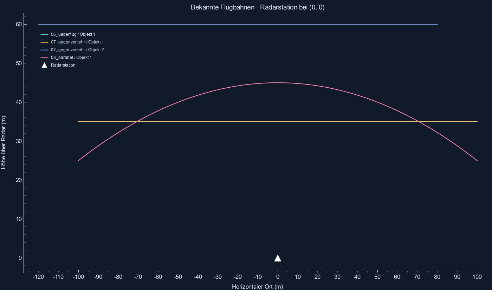
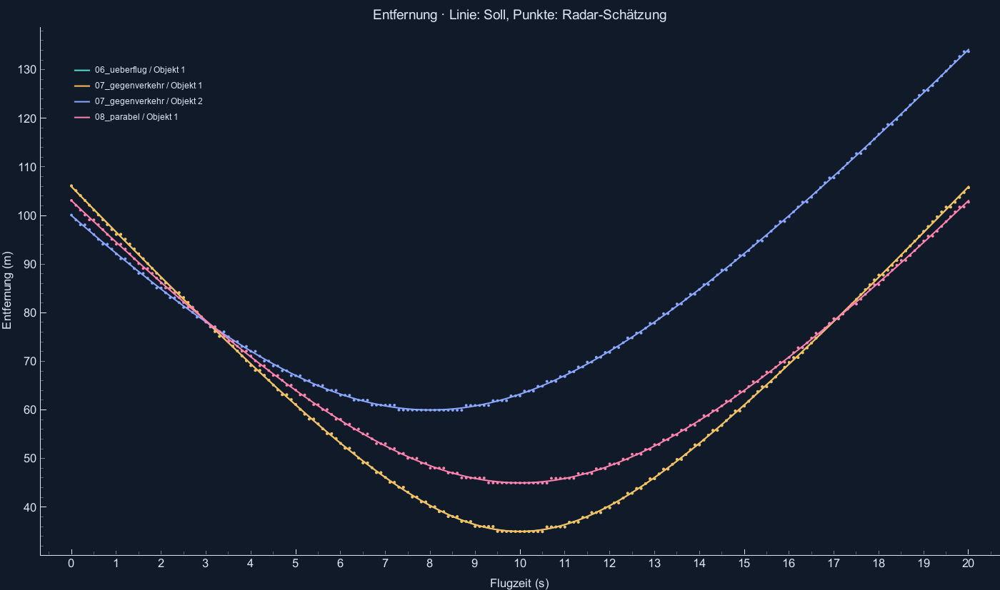
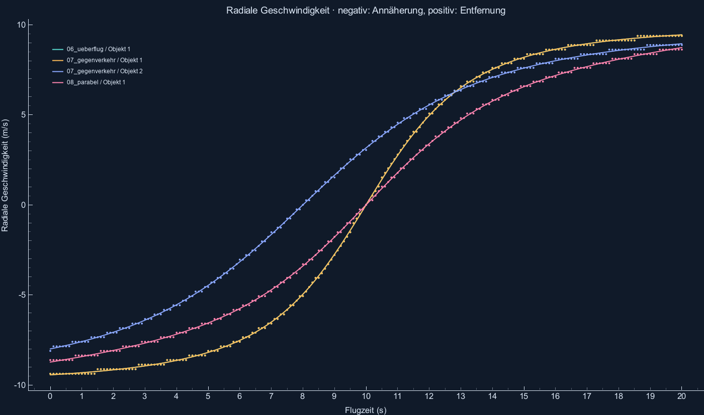

# Validierung der drei Flugbeispiele

Reproduzieren: `python -m radar_sim --validate`. Seed 42, Referenz-SNR 0 dB.
Je Szene 20 s Flugzeit, 0,1 s Zeitschritt, 201 berechnete Radar-Messpakete.

| Flug | Messpakete | Sollobjekte über alle Zeiten | Fehlende Zuordnungen | max. Entfernungsfehler / m | max. Geschwindigkeitsfehler / m/s | Ergebnis |
|---|---:|---:|---:|---:|---:|---|
| Ein Objekt: Überflug in 35 m Höhe | 201 | 201 | 0 | 0.500966 | 0.123975 | BESTANDEN |
| Zwei Objekte: entgegengesetzte Flugrichtung | 201 | 402 | 0 | 0.503531 | 0.126864 | BESTANDEN |
| Ein Objekt: parabelförmiger Überflug | 201 | 201 | 0 | 0.500507 | 0.125911 | BESTANDEN |

Die Grenzwerte sind ΔR/2 + c·Δfd/(4S) und Δv/2, jeweils mit 1 % Rechenspielraum.
Geprüft werden die Schätzfehler aller zugeordneten Ziele und das Fehlen von Zuordnungen.
Zusätzliche Erkennungen durch Rauschen sind weiterhin möglich; siehe die allgemeine CFAR-Validierung.
RMSE (Wurzel des mittleren quadratischen Fehlers), Einzelmessungen und fehlerhafte Frame-Nummern stehen in [fluege.json](fluege.json).

Die Flugbahn ist bekannt. Höhe und horizontaler Ort sind keine Radar-Schätzwerte.
Bei Gegenverkehr können beide Objekte gleichzeitig auf die Station zufliegen: entgegengesetzte Flugrichtung bedeutet nicht automatisch entgegengesetzte radiale Geschwindigkeit.
Die Parabel ist eine vorgegebene Bahn eines gesteuerten Flugobjekts mit −0,4 m/s² senkrechter Beschleunigung, keine freie Wurfbewegung.

Einzelüberflug und Objekt 1 des Gegenverkehrs haben dieselbe Bahn; ihre Kurven liegen in den Diagrammen übereinander.

