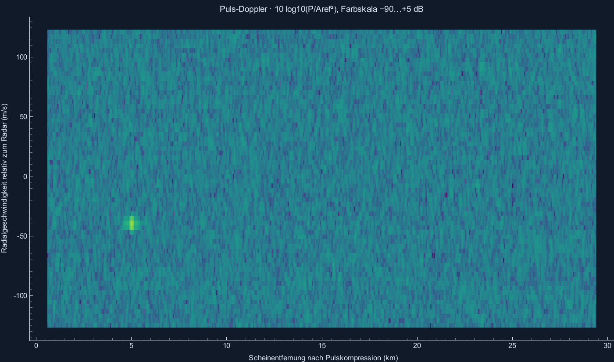
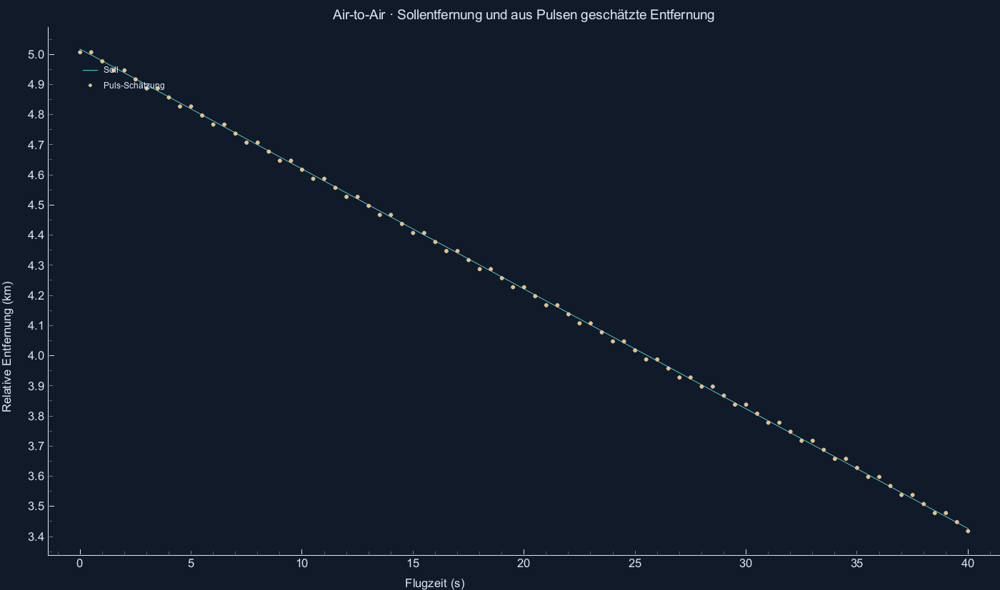

# Puls-Doppler und bewegtes Radar

Reproduzieren: `python -m radar_sim --validate`.

Lehrprofil: fc=3 GHz, B=2 MHz, Tp=4 µs, Tr=200 µs, fs=5 MHz, M=64; komplexer LFM-Empfang und lineare Pulskompression.
ΔR=74,9481 m, ADC-Bin=29,9792 m, Δv=3,90355 m/s, |v|<124,914 m/s. Theoretisch Runamb=29.979,2 m; volle Echos bei 599,585≤R≤29.379,7 m. CFAR-Ränder begrenzen die Detektion zusätzlich.

| Pulsprüfung | Soll | Zugeordnet | Extra | Max. Fehler R / m | Max. Fehler v / m/s | Ergebnis |
|---|---:|---:|---:|---:|---:|---|
| stationaer_ohne_awgn | 1 | 1 | 0 | 6.534048599999551 | 0.0 | OK |
| gegenverkehr_ohne_awgn | 2 | 2 | 0 | 7.390887457811914 | 1.228381041666669 | OK |
| gleiche_entfernung | 2 | 2 | 0 | 4.385052857811388 | 0.9645236979166683 | OK |

Toleranzen: halber ADC-Entfernungsbin plus Dopplerkorrekturfehler; halber Dopplerbin. Kein interpolierter Schätzer.

## Zwei Flugzeuge, eines mit Radar

Radar: 160 m/s bei 1800 m; Target: 200 m/s bei 2100 m, seitlich 300 m versetzt. 40 s. R und v werden aus der Differenz beider Weltbewegungen berechnet. Die Plattform ist kein Eigenziel.

Rauschfrei gilt die halbe Rasterweite plus Kopplungskorrektur. Bei AWGN kann ein benachbarter Bin gewinnen; für die hier gemessene 20-dB-Stichprobe wird höchstens eine halbe nominelle Entfernungsauflösung zugelassen. Das ist kein allgemeines Genauigkeitsversprechen für beliebiges SNR.

| Modus | AWGN | Frames | Fehlend | Extra | Max. Fehler R / m | Max. Fehler v / m/s | Ergebnis |
|---|---|---:|---:|---:|---:|---:|---|
| fmcw | False | 81 | 0 | 0 | 14.845140536384406 | 0.6813845600795716 | OK |
| fmcw | True | 81 | 0 | 4 | 14.845140536384406 | 0.6813845600795716 | OK |
| pulse_doppler | False | 81 | 0 | 0 | 14.9039623525573 | 0.8212966615207264 | OK |
| pulse_doppler | True | 81 | 0 | 4 | 15.376926729607021 | 0.8212966615207264 | OK |

fmcw, AWGN=False: R-Toleranz 15.059 m; 0 Frames überschreiten die engere rauschfreie Halb-Bin-Grenze.
fmcw, AWGN=True: R-Toleranz 15.059 m; 0 Frames überschreiten die engere rauschfreie Halb-Bin-Grenze.
pulse_doppler, AWGN=False: R-Toleranz 15.0013 m; 0 Frames überschreiten die engere rauschfreie Halb-Bin-Grenze.
pulse_doppler, AWGN=True: R-Toleranz 37.4741 m; 1 Frames überschreiten die engere rauschfreie Halb-Bin-Grenze.

## Reines Rauschen

48 unabhängige Frames je Fenster. Intervall aus der Streuung der Frame-Raten, keine Unabhängigkeitsannahme über einzelne CUTs.

| Fenster | CUTs | Alarme | Pfa nominal | Pfa gemessen | 95-%-Intervall |
|---|---:|---:|---:|---:|---|
| rect | 2168064 | 2397 | 0.001 | 0.00110559 | [0.0010503629938544772, 0.0011608263437296532] |
| hann | 2168064 | 2854 | 0.001 | 0.00131638 | [0.0012383243084747486, 0.0013944392999796144] |

Entfernungszellen nach Pulskompression sind korreliert, auch bei Rechteck. Die nominale Pfa ist kein kalibriertes Fehlalarmversprechen.

## SNR-Stichprobe

SNR vor Kompression, bezogen auf ein aktives Echo mit Amplitude 1, kein PRI-Mittel und kein aufsummiertes Szenen-SNR.

| SNR / dB | Zugeordnet / 24 | Extra |
|---:|---:|---:|
| -35 | 0 | 1 |
| -20 | 0 | 1 |
| 0 | 24 | 1 |
| 20 | 24 | 1 |

Die unabhängigen Unit-Tests vergleichen RX gegen verzögerte Basisbandpulse und die FFT-Kompression gegen direkte Korrelation. Sie prüfen außerdem Blindbereich, Doppler-/PRI-Grenzen, ADC und Speicher, JSON, Slider und Null-Doppler ohne Rundungsgeister.

Gesamtergebnis der harten Schätzprüfungen: **BESTANDEN**.
Herleitung und ehrliche Vor-/Nachteile: [Puls-Doppler und Plattform](../docs/PULS_DOPPLER.md).
