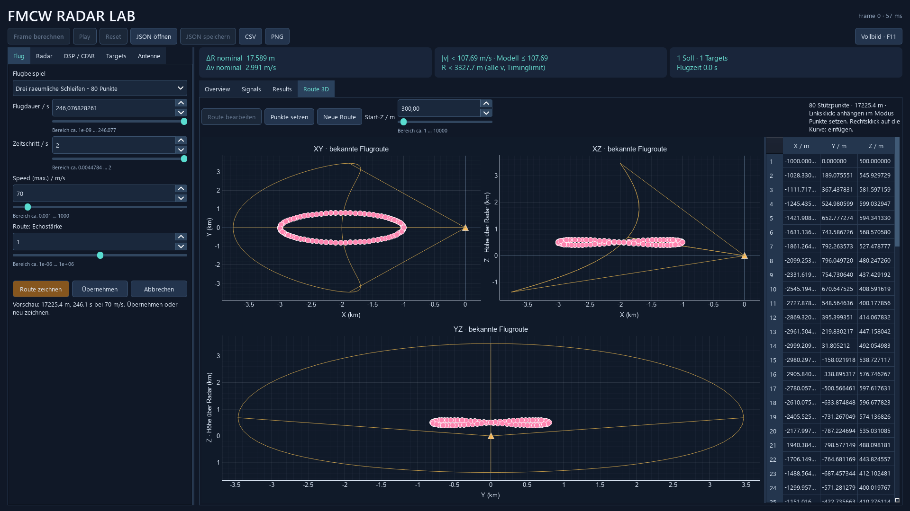

# Lange Routen und sichere Übernahme

Prüfstand: 19.10.2026. Die feste Flugdauergrenze wurde entfernt; Entwürfe bleiben bei einer fehlgeschlagenen Gesamtprüfung im Editor.

## Tatsächlich durchgeführte Prüfungen

- Vollständige Suite: **65 Tests bestanden**. Die Prüfung der langsameren 256-Punkte-Route wurde anschließend nochmals mit 0,05 m/s erfolgreich ausgeführt.
- `python -m radar_sim --validate`: **BESTANDEN**, Exitcode 0. Sämtliche bestehenden Modell-, CFAR- und Flugberichte wurden neu erzeugt.
- Native Qt-Plattform `windows`: Start einer Route über 120 s und Erhalt eines fehlerhaften 80-Punkte-Entwurfs bis zur erfolgreichen Korrektur geprüft; beide Tests bestanden, abschließender Prozess-Exitcode 0.
- Absichtlich zu großes CFAR-Fenster: Übernehmen lehnt die Kombination ab, behält die Punktkoordinaten bitgleich, lässt den Editor offen und ersetzt das bisherige Ergebnis nicht. Nach Korrektur lässt sich dieselbe Route übernehmen und wieder bearbeiten.
- Dreidiagonal gelöste natürliche Interpolation für 37 ungleich verteilte 3D-Punkte gegen unabhängig aufgebautes NumPy-Matrixsystem geprüft: Übereinstimmung mit rtol 1e-11, atol 1e-12.
- Unterschiedliches Tempo liefert dasselbe zwischengespeicherte Geometrieobjekt.

## Vollständiger Lauf des neuen Beispiels

Datei: [14_mehrfachschleife_3d.json](../examples/14_mehrfachschleife_3d.json). Drei räumliche Schleifen, 80 Punkte, 70 m/s, Fächerantenne, AWGN mit 20 dB SNR und Pfa 1e-6.

- Bogenlänge: 17225.377978299 m.
- Flugdauer: 246.076828261 s bei 2 s Zeitschritt; letzter Frame exakt am Routenende.
- Alle 125 Frames berechnet: 125 zugeordnete Sollwerte; 0 fehlende und 4 zusätzliche Detektionen.
- ADC-Vorlauf: 222 Samples; aktive Rampe 62.200000000 µs; weiterhin 400 aufgenommene Samples pro Chirp.
- Angepasstes Profil: fc=11.188854944 GHz, B=13.252246726 MHz, M=72.

Rohdaten einschließlich tatsächlicher Fehler und zusätzlicher Peaks: [routen_manoever.json](routen_manoever.json). Neue Zahlen behaupten keine garantierte Objekterkennung bei beliebigen anderen Kurven oder Rauschfolgen.

## Ressourcengrenzen und Bedienung

Der 256-Punkte-Test fliegt vier ebene Schleifen bei 0,05 m/s: Dauer 30159.246739 s (8.378 Stunden), Zeitschritt 30 s. Start-, Mittel- und Endframe wurden einzeln berechnet, die komplexen Arrays behalten ihre feste Frameform. JSON-Export und -Import sind identisch.

Die Route darf nicht den Boden berühren oder eine Umkehr mit verschwindender Tangente erzwingen. Maximal 256 Stützpunkte begrenzen die interaktive Geometriearbeit; weiterhin höchstens 1.048.576 Samplezellen pro Radarframe. Ungültige Geometrie wird erklärt und bleibt bearbeitbar.

Die Architektur und die entfernten Wiederholungen sind in [ROUTEN_UND_CODE.md](../docs/ROUTEN_UND_CODE.md) beschrieben.

