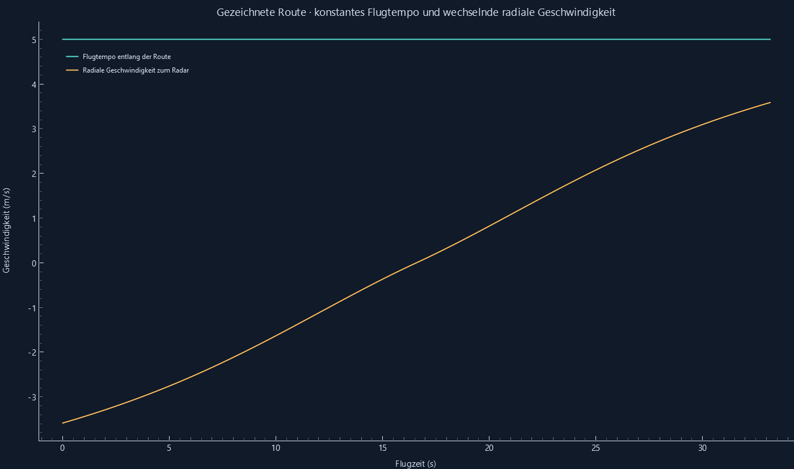

# Gezeichnete Route und gekoppelte Regler

Reproduzieren: `python -m radar_sim --validate`. Beispiel: `examples/09_gezeichnete_route.json`.

Eine natürliche kubische Kurve verbindet (−80,35), (0,55) und (80,35) m. Das Flugtempo ist 5 m/s.

- Berechnete Länge: 165.848095609 m; Flugdauer: 33.169619122 s.
- 333 Radar-Messpakete, 0 fehlende Zuordnungen, 0 Pakete außerhalb der üblichen FFT-Toleranzen.
- Größte Tempoabweichung: 8.88e-16 m/s.
- Radiale Geschwindigkeit gegen zentrale numerische Ableitung der Entfernung: maximal 1.39e-10 m/s Abweichung, Schritt 0,1 ms.
- 4080 Minimum-/Maximum-/Mittelpunkt-Prüfungen nach 80 reproduzierbaren Parameteränderungen, 0 Abweichungen von der Kernprüfung.

Die Reglerbereiche gelten jeweils bei festgehaltenen übrigen Werten und enthalten einen kleinen numerischen Sicherheitsabstand an Modellgrenzen. Sie garantieren gültige Modellparameter, keine bestimmte Detektionswahrscheinlichkeit. Direkt eingetippte ungültige Werte werden angezeigt und erklärt. Andere Werte werden nicht automatisch verändert.

Die Route wird nach Bogenlänge parametrisiert. Enge Umkehrpunkte und Bodenüberschwinger werden abgewiesen; die Beschleunigungsschranke verwendet die Krümmung der geglätteten Kurve. Die Animation endet am letzten Punkt; Start- und Bremsvorgänge werden nicht simuliert.

Gesamtergebnis: **BESTANDEN**.
Rohwerte: [route_und_regler.json](route_und_regler.json).
