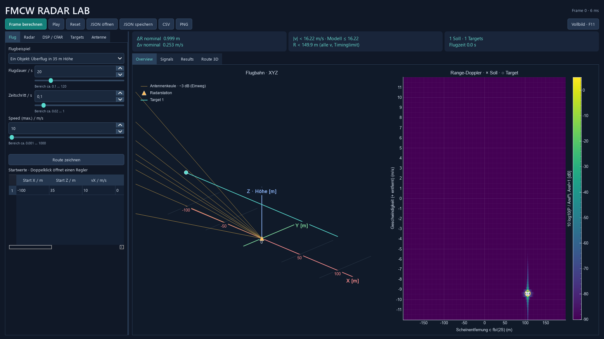
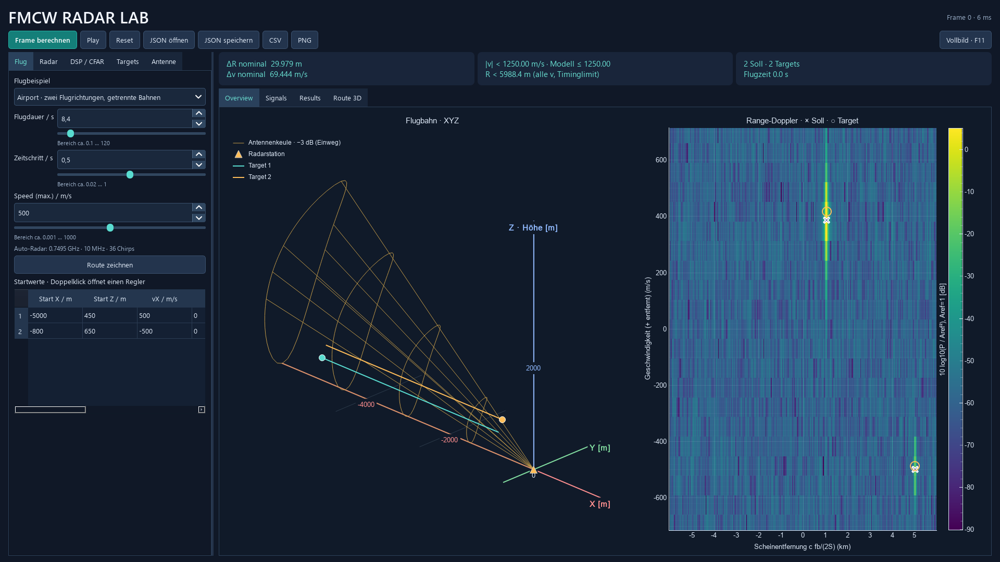

# Speed, Szenarioauswahl und Routenzoom

Prüfstand: 19.10.2026. Reproduzierbarer Kernversuch: `python -m unittest discover -s tests -p test_tempo_anpassung.py -v`. GUI-Prüfungen stehen in `tests/test_gui.py` und laufen mit der vollständigen Testsuite.

## Hohe Geschwindigkeiten

Ausgangspunkt ist Airport-Gegenverkehr mit zwei räumlich getrennten Bahnen, ausgeschaltetem AWGN und aktiver Fächerantenne. Die Strecken bleiben gleich, das Tempo wird skaliert. Je Tempo wurden Start, mittlerer Frame und Endframe geprüft: insgesamt 15 Frames und 30 Sollwerte. Alle 30 wurden zugeordnet. Die Tabelle enthält tatsächlich gemessene Maximalfehler. Rohdaten: [speed_und_ansicht.json](speed_und_ansicht.json).

| Speed / m/s | Träger / GHz | Chirps | Δv / m/s | max. Range-Fehler / m | max. Geschwindigkeitsfehler / m/s |
|---:|---:|---:|---:|---:|---:|
| 100 | 6.675066 | 96 | 2.923977 | 14.802061 | 1.427115 |
| 250 | 2.301978 | 63 | 12.919897 | 14.162623 | 3.503225 |
| 500 | 0.749481 | 36 | 69.444444 | 14.786960 | 29.065400 |
| 1000 | 0.374741 | 36 | 138.888889 | 14.786960 | 58.130800 |
| 1500 | 0.249827 | 36 | 208.333333 | 14.786960 | 87.196201 |

Alle Profile dieses Versuchs behalten 10 MHz Bandbreite und das 40-µs-ADC-Fenster; ΔR beträgt rund 29,979 m. Fehlertoleranz: halber Doppler-Bin sowie halber Range-Bin plus der aus dem Doppler-Binfehler übernommenen Kopplung `fc/S·Δv/2`. Hohe Geschwindigkeiten werden mit geänderten Radarwerten berechnet, nicht mit umbeschrifteten FFT-Achsen.

Die sinkende Trägerfrequenz und teilweise kürzere Chirpfolge verschlechtern hier die Geschwindigkeitsauflösung. Dies ist kein unverändertes Airport-Radar und keine Detektionsgarantie für beliebige Ziele. Im zusätzlich betrachteten kleinen Nahbereichs-Gegenverkehr verschmolzen bei 500, 1000 und 1500 m/s die beiden Targets zu einem Peak; ihre Trennung reicht bei der gröberen Auflösung nicht mehr aus.

## Oberfläche

- Zweimal durch alle sieben gespeicherten Flugbeispiele wechseln sowie dreimal dieselbe Konfiguration als neue Dataclasses laden: Anzahl der Einträge bleibt gleich, alle Namen eindeutig.
- GUI-Gegenverkehr mit 500 m/s und eigene 3D-Route mit 1500 m/s erfolgreich berechnet. Range-Doppler umfasst die Geschwindigkeiten mit Reserve. Zurückstellen auf 70 m/s stellt das vorherige Radarprofil wieder her.
- Direkter Überflug mit 6 km Keulen-Zeichenlänge: projizierte Route nimmt in der begrenzenden Fensterdimension 60 % ein (Testtoleranz ±2,5 Prozentpunkte). Der nächste Frame erhält den Zoom.
- Die drei betreffenden GUI-Tests wurden zusätzlich mit der nativen Qt-Plattform `windows` bestanden; Exitcode 0.
- Vollständige Suite: 62 Tests bestanden. Historischer Prüfstand vor der Routenüberarbeitung: Die Zeitgrenze von 120 s ist inzwischen entfernt. Aktuelle Prüfungen: [ROUTEN_MANOEVER.md](ROUTEN_MANOEVER.md). Speicher- und Geometrieprüfungen bleiben aktiv.

