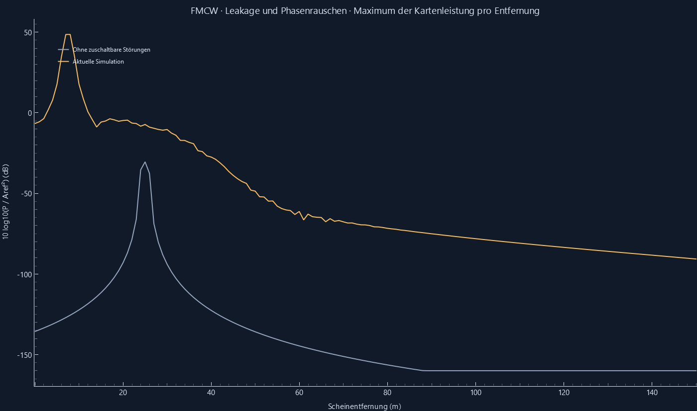
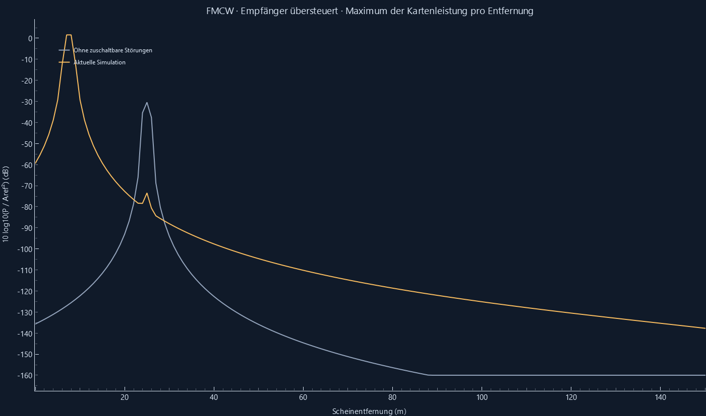
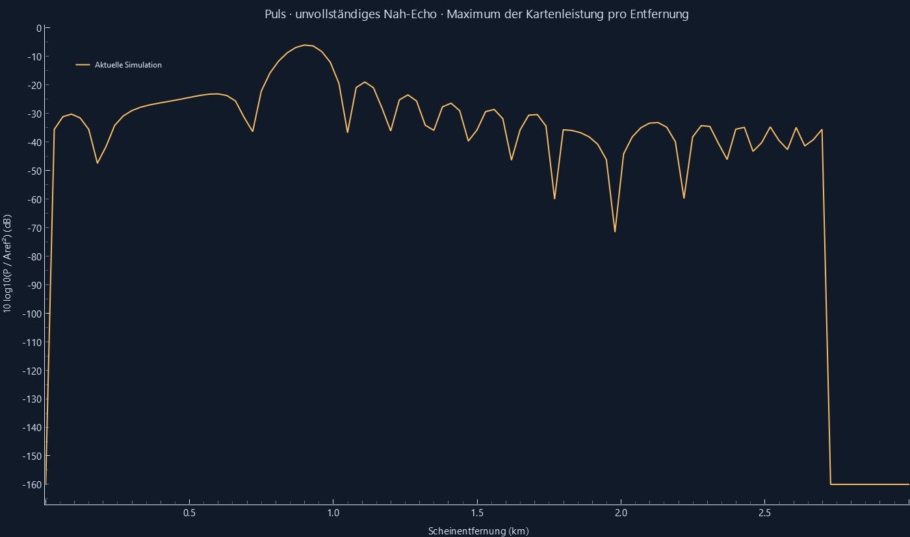
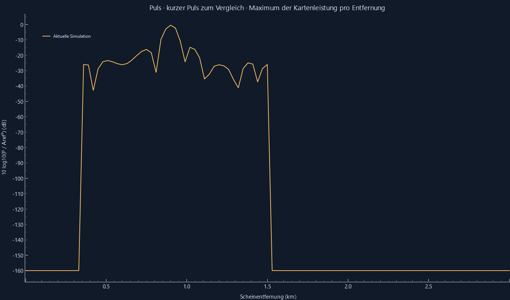
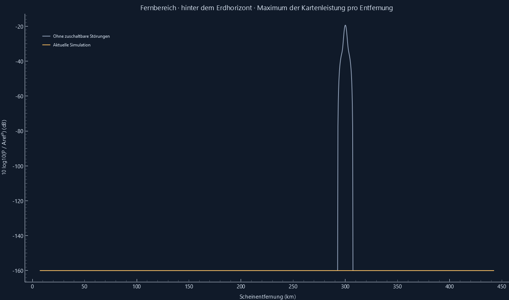
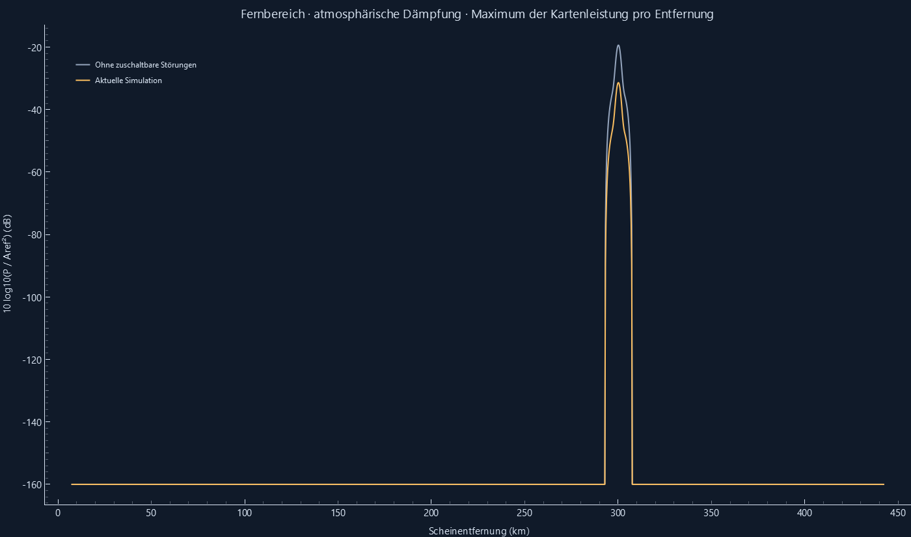
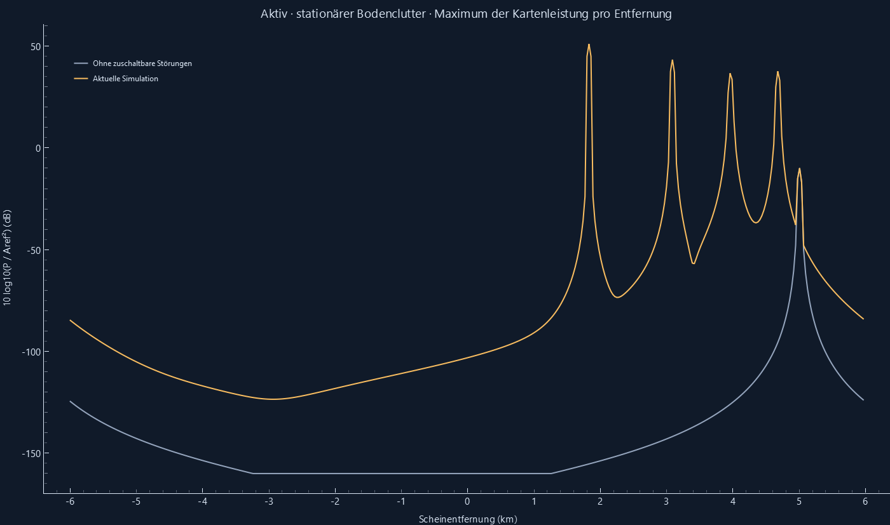
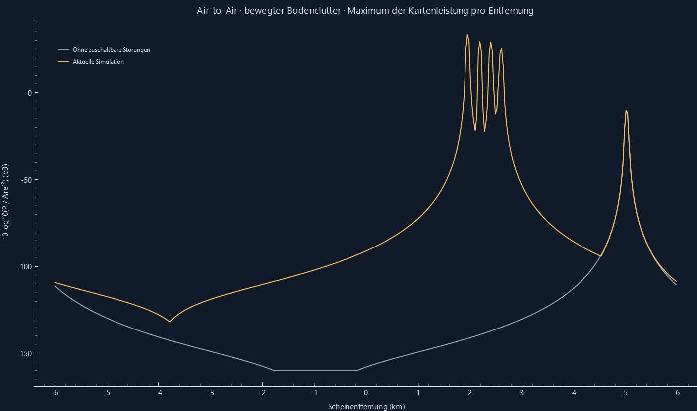
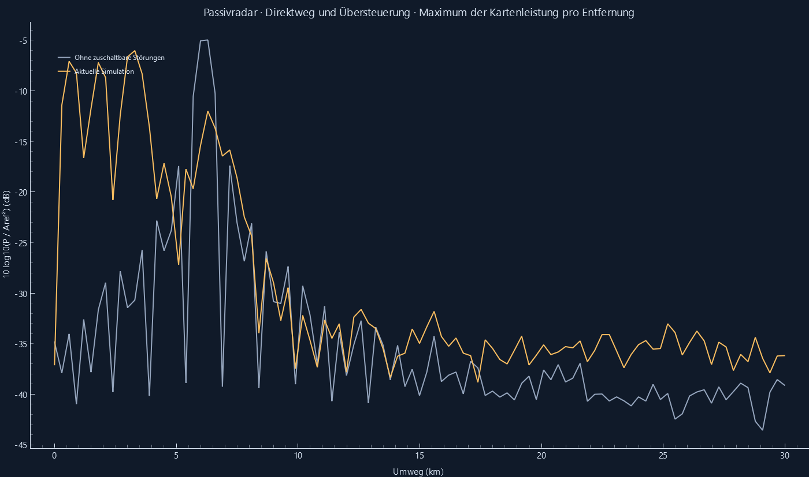

# Zuschaltbare Störmodelle: tatsächliche Ergebnisse

Reproduzieren: `python -m radar_sim --validate`. Unabhängige Zusatzprüfungen: `python -m unittest tests.test_effekte -v`.

Die Prüfkriterien beziehen sich auf die dokumentierten Ersatzmodelle, nicht auf eine Hardware- oder Wetterkalibrierung.

| Analytischer / statistischer Check | Ist | Soll | Toleranz | Ergebnis |
|---|---:|---:|---:|---|
| Leakage-Leistung am binzentrierten Peak / Aref² | 100 | 100 | 1e-09 | OK |
| Leakage-Beat / Hz | 400000 | 400000 | 1e-07 | OK |
| Restphasenvarianz bei τ=Tc / rad² | 0.1944621615 | 0.1967346701 | 0.02 | OK |
| Restphasenvarianz bei τ=8Tc / rad² | 0.5015068426 | 0.5 | 0.05 | OK |
| Amplitude-Limit / Aref | 1 | 1 | 1e-14 | OK |
| Begrenzter Anteil im Vier-Sample-Beispiel | 0.5 | 0.5 | 1e-14 | OK |
| Sichtbarkeit bei 0.999 × Horizont | 1 | 1 | 0 | OK |
| Sichtbarkeit bei 1.001 × Horizont | 0 | 0 | 0 | OK |
| Atmosphäre, Zweiweg-Leistungsverlust / dB | -12.00666482 | -12.00666482 | 1e-09 | OK |
| Teilpuls: Peakleistung bei halbem Empfang | 0.25 | 0.25 | 1e-10 | OK |
| Kurzer Puls: vollständige Peakleistung | 1 | 1 | 1e-10 | OK |
| Mittlere Boden-RCS über 200 Seeds / m² | 188.8870413 | 188.4955592 | 7.5398 | OK |

Phasenstatistik: zwölf unabhängige Realisierungen, je 4950 Samples auf Tc/8-Raster; Samples sind korreliert. Die festen Toleranzen berücksichtigen diese endliche Stichprobe und die diskrete Filterung.
Sichthorizont als Bogenentfernung für 20 m und 1000 m bei k=4/3: 148770.029 m.

## Demonstrationsszenen

Detektionsausfälle und zusätzliche Peaks sind hier ausdrücklich erwartete, gemessene Folgen. Extras können Clutter, Leakage oder Nebenkeulen sein; sie werden nicht pauschal als Rauschfehlalarme bezeichnet.

| Szene | Frame | Soll | Zugeordnet | Extra | Begrenzt / % |
|---|---:|---:|---:|---:|---:|
| FMCW · Leakage und Phasenrauschen | 0 | 1 | 0 | 1 | 0.000 |
| FMCW · Empfänger übersteuert | 0 | 1 | 1 | 1 | 100.000 |
| Puls · unvollständiges Nah-Echo | 0 | 1 | 1 | 9 | 0.000 |
| Puls · kurzer Puls zum Vergleich | 0 | 1 | 1 | 4 | 0.000 |
| Fernbereich · hinter dem Erdhorizont | 0 | 1 | 0 | 0 | 0.000 |
| Fernbereich · hinter dem Erdhorizont | 30 | 1 | 0 | 0 | 0.000 |
| Fernbereich · hinter dem Erdhorizont | 60 | 1 | 0 | 0 | 0.000 |
| Fernbereich · atmosphärische Dämpfung | 0 | 1 | 1 | 0 | 0.000 |
| Fernbereich · atmosphärische Dämpfung | 30 | 1 | 1 | 0 | 0.000 |
| Fernbereich · atmosphärische Dämpfung | 60 | 1 | 1 | 0 | 0.000 |
| Aktiv · stationärer Bodenclutter | 0 | 1 | 1 | 4 | 0.000 |
| Aktiv · stationärer Bodenclutter | 60 | 1 | 1 | 4 | 0.000 |
| Aktiv · stationärer Bodenclutter | 120 | 1 | 1 | 4 | 0.000 |
| Air-to-Air · bewegter Bodenclutter | 0 | 1 | 1 | 14 | 0.000 |
| Air-to-Air · bewegter Bodenclutter | 8 | 1 | 1 | 18 | 0.000 |
| Air-to-Air · bewegter Bodenclutter | 16 | 1 | 1 | 15 | 0.000 |
| Passivradar · Direktweg und Übersteuerung | 0 | 1 | 0 | 2 | 99.998 |
| Passivradar · Direktweg und Übersteuerung | 20 | 1 | 0 | 2 | 99.991 |
| Passivradar · Direktweg und Übersteuerung | 40 | 1 | 0 | 2 | 99.995 |

Die Puls-Nahbereichsdemo nutzt Rechteckgewichtung für die einfache analytische Teilpuls-Referenz. Ihre Nebenkeulen können zusätzliche lokale CFAR-Peaks erzeugen. Hann verändert Hauptkeule und Teilpuls-Gewichtung.
Keine gleiche mittlere Sendeleistung zwischen Radarverfahren behauptet. Der graue Vergleich behält Wellenform, Seed, Masthöhe und Puls-Sendesperre; nur die sechs optionalen Störungen entfallen.

[Signalmodell und Grenzen](../docs/STOEREFFEKTE.md)

Gesamtergebnis der Modellprüfungen: **BESTANDEN**.
