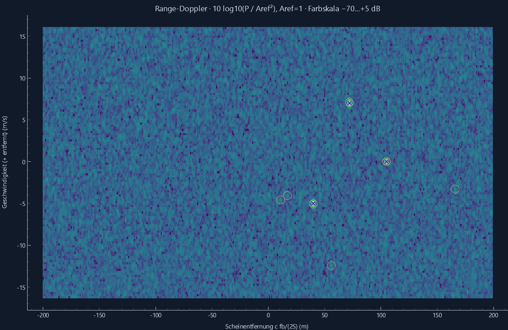
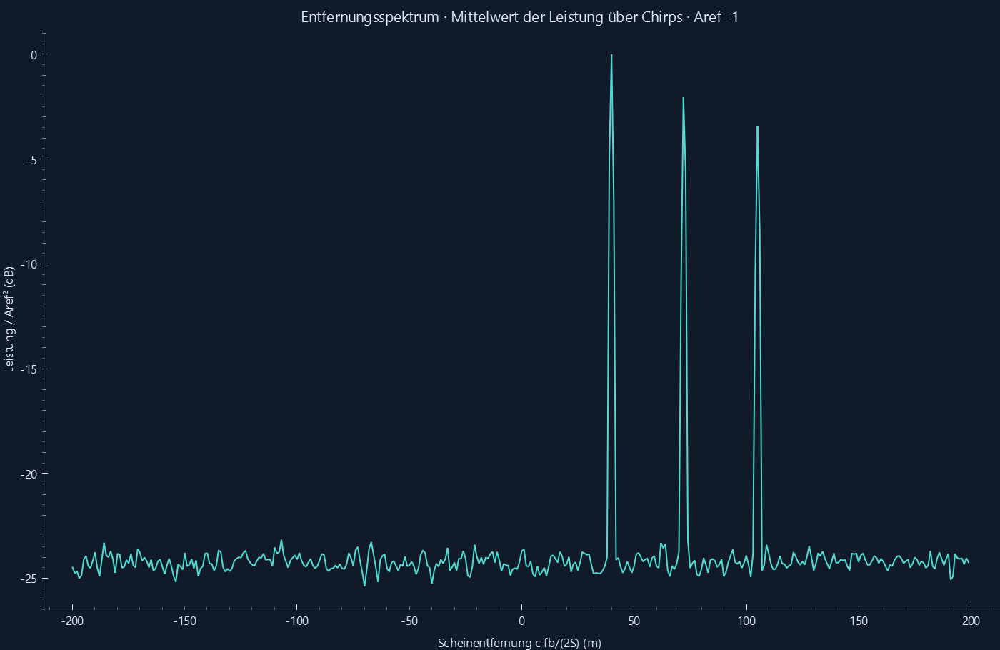
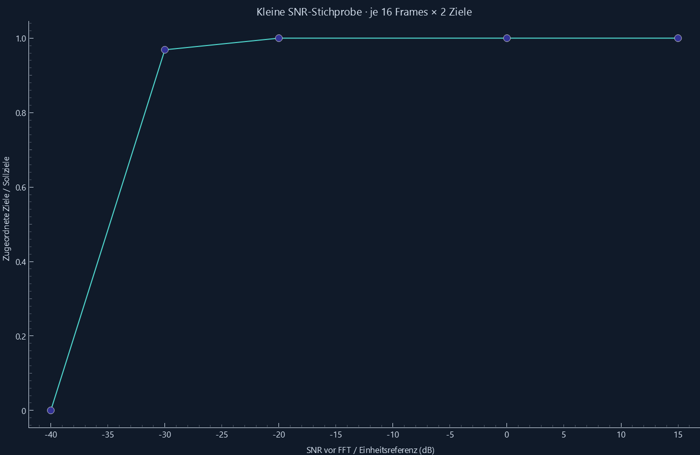
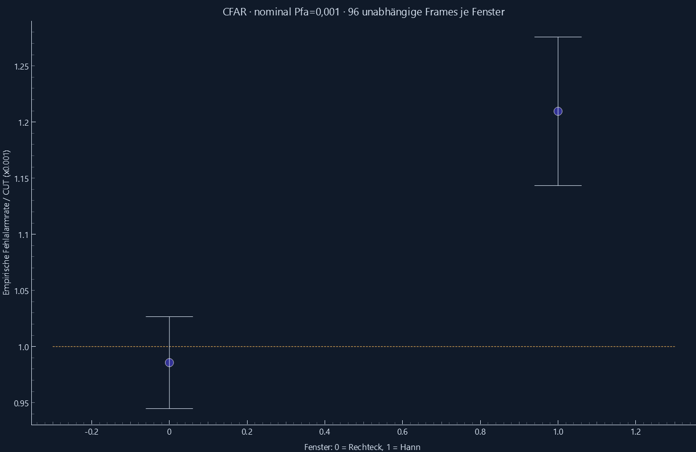

# Gemessener Validierungsbericht

Python 3.14.7, NumPy 2.5.3; Windows-11-10.0.26200-SP0.
Reproduzieren: `python -m radar_sim --validate`. Szenen-Seed 42; Rausch-Monte-Carlo Seed 2026.

| Szenario | Soll | Kandidaten | Zugeordnet | max. ΔR abs. / m | max. Δv abs. / m/s | Ergebnis |
|---|---:|---:|---:|---:|---:|---|
| 01_stationary | 1 | 1 | 1 | 0.000000 | 0.000000 | BESTANDEN |
| 02_approach_recede | 2 | 2 | 2 | 0.124914 | 0.000000 | BESTANDEN |
| 03_two_ranges | 2 | 2 | 2 | 0.000000 | 0.000000 | BESTANDEN |
| 03_same_range_two_velocities | 2 | 2 | 2 | 0.104095 | 0.000000 | BESTANDEN |
| 04_cfar_noise | 2 | 7 | 2 | 0.093685 | 0.000000 | BESTANDEN |
| 05_dashboard | 3 | 7 | 3 | 0.195543 | 0.097359 | BESTANDEN |
| near_resolution | 2 | 1 | 1 | 0.000000 | 0.000000 | DEMO |

Nullzuordnungen sind fehlende Detektionen; ein Fehlerwert 0 bei fehlender Zuordnung ist kein erfolgreicher Schätzwert.
Toleranz: ΔR/2 + c·Δfd/(4S), Δv/2. Es wird das Maximum einer diskreten FFT-Zelle verwendet, ohne Interpolation.
Hann verbreitert Hauptkeulen; das Grenzfallbeispiel bewertet die beobachtete Trennung und ist kein Bestehenstest.

## Rauschmessung

| Fenster | Gültige CUTs | Fehlalarme | Pfa gemessen | 95-%-Intervall (Frame-Mittel) |
|---|---:|---:|---:|---|
| rect | 1751040 | 1726 | 0.0009857 | [0.000944758, 0.00102664] |
| hann | 1751040 | 2118 | 0.00120957 | [0.0011434, 0.00127573] |

96 unabhängige Frames je Fenster, Pfa nominal 0,001. Intervalle: Normalapproximation aus der Streuung der Frame-Raten.
Rechteck-Prüfung: Abweichung ≤ max(4 Standardfehler, 15 % der Pfa). Hann wird gemessen, aber nicht gegen die Unabhängigkeitsformel bestanden.
Überlappende CFAR-Trainingsringe erzeugen abhängige Entscheidungen; Fensterung korreliert zusätzlich die FFT-Bins.

## SNR-Sweep

SNR ist vor Fenster/FFT auf Einheitsleistung bezogen, kein SNR der summierten Szene.
16 Frames je SNR, zwei Ziele pro Frame. Die Zuordnungsquote innerhalb des Gates ist eine kleine Demonstrationsstichprobe, keine allgemeine Pd-Kurve.

| SNR / dB | Zugeordnet / 32 | Zusätzliche Kandidaten |
|---:|---:|---:|
| -40 | 0 | 38 |
| -30 | 31 | 38 |
| -20 | 32 | 38 |
| 0 | 32 | 38 |
| 15 | 32 | 38 |

Die drei bewegten Flugbeispiele werden an jedem Zeitschritt geprüft: [Flugbericht](FLUEGE.md).

Zusätzliche Prüfung ohne AWGN, analytische Grundlagen und Rechteck-Gegenbeispiel: [Detektionsbericht](DETEKTION.md).

Eine frei definierte Flugkurve mit konstantem Tempo und die gekoppelten Parameterbereiche: [Route und Regler](ROUTE_UND_REGLER.md).

Flughafenszenen mit 3D-Bewegung und aktiver Richtwirkung: [Airport und 3D](AIRPORT_3D.md).

Antennendiagramme gegen Element-Summen und analytische Halbwerte: [Antennen](ANTENNEN.md).

LFM-Puls-Doppler, Relativbewegung beider Flugzeuge und gemessene CFAR-Raten: [Puls und Plattform](PULS_UND_PLATTFORM.md).

300-km-Profile, Trennungsdemo und passive bistatische CAF: [Fernbereich und Passivradar](FERN_UND_PASSIV.md).

Leakage, Sättigung, Phasenrauschen, Horizont, Atmosphäre und Bodenclutter: [Störmodelle](STOEREFFEKTE.md).

Gesamtergebnis der harten Prüfungen: **BESTANDEN**.
Rohwerte und Einzelabweichungen: [validation.json](validation.json).
